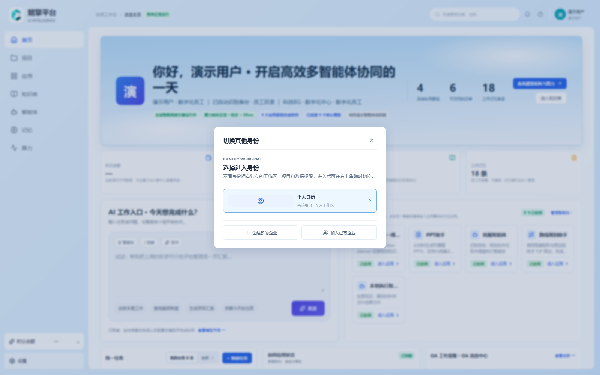
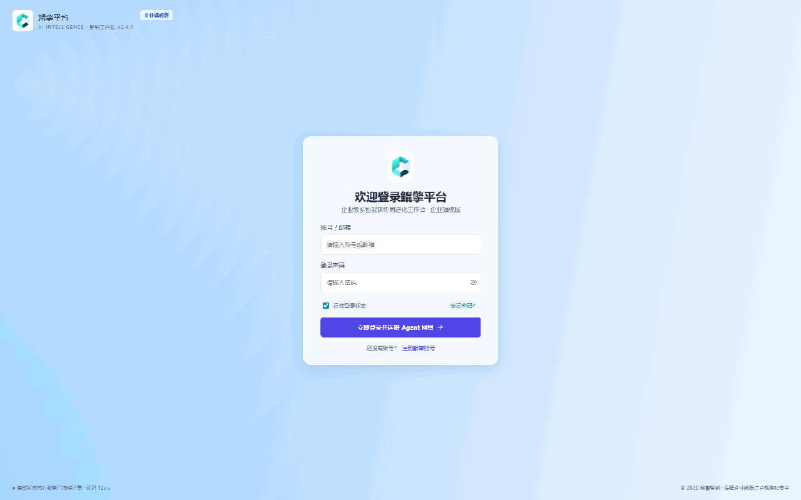
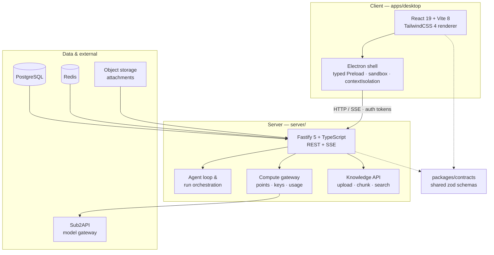

# KLA Workstation

**Enterprise multi-agent collaboration workstation — client + server.**

[](LICENSE)
[](https://nodejs.org)
[](https://pnpm.io)
[](https://www.typescriptlang.org)
[](.github/workflows/ci.yml)

<p align="center">
  
</p>

KLA Workstation is an enterprise-grade workbench where humans and AI agents
collaborate in group chats, shared knowledge bases, and long-running
multi-step tasks. It ships as a **React + Vite renderer** with a thin,
security-hardened **Electron shell**, backed by a **Fastify + TypeScript
server** with PostgreSQL persistence and a pluggable compute gateway
(sub2api-style billing, API keys, usage tracking).

The flagship module is **SANY Strategic Planning** (`三一战略规划协同`): a
full role-based workflow — administrators dispatch tasks to business units,
owners prepare materials and prefill content, and everything converges into
a reviewed, merged company-level plan with traceable field provenance.

---

## ✨ Features

### Collaboration
- **Multi-agent group chats** — create projects, assemble agent groups, watch
  runs execute step by step with a live event log and produced artifacts.
- **Agent management** — mount models per agent, manage skills, and inspect
  server-side and local execution tools from one panel.
- **Long-term memory** — identity-scoped, project-scoped, and group-scoped
  memory with a browser UI and server-side persistence.

### Knowledge
- **Knowledge bases** at personal / project / enterprise scope, file upload
  with async parsing progress, chunk-level reading, and keyword + vector
  retrieval behind a unified search API.
- **Excel analysis chain** — pure-JS (exceljs) spreadsheet processing with
  SVG report generation; no Python runtime required.
- **PPT assistant** — deterministic `DeckSpec → PPTX` engine bundled as a
  self-contained agent skill (offline, auditable, no external renderer).

### SANY Strategic Planning
- **Two roles, one platform**: administrators (`集团战略管理部`) and unit
  owners (`业务单元`) share a context-isolated workspace.
- **Full lifecycle**: organization roster → company-level reporting →
  verification → task dispatch → owner material prep → content prefill →
  gap handling → output submission → aggregation & merge → company-level
  results with six delivery checks.
- **Provenance everywhere**: every merged figure traces back to a confirmed
  field, every submission carries version history, and drafts are tracked
  per unit.

### Platform
- **Compute & billing** — points wallet, API key management, usage records,
  and a model market view wired to a Sub2API compute gateway.
- **Server-authoritative security** — accounts, identities, permissions,
  knowledge, memory, and role definitions live only on the server. The
  renderer caches and drafts; it never touches the database or model keys.
- **Local tools with approval** — the Electron shell exposes typed,
  per-call-approved local execution (file read/write, shell commands) with
  configurable workspace roots. No inbound ports, no silent file access.
- **Mock mode** — run the entire stack against an in-memory server
  (`demo@kla.local` / `demo123456`) with zero external dependencies.

---

## 🎬 Demo

A real end-to-end walkthrough recorded against the mock server — login,
home overview, the SANY planning admin flow (7 pages), the owner flow
(4 pages), knowledge base, and the compute dashboard:



> Recorded from the actual dev build (Chrome headless). If the GIF does not
> play in your reader, see the static screenshots under `docs/assets/`.

---

## 🏗️ Architecture



### Monorepo layout

| Directory | Description |
|---|---|
| `apps/desktop` | React + Vite renderer + thin Electron shell (window, typed Preload only) |
| `apps/points-admin` | Points administration console (operators) |
| `server` | Fastify + TypeScript API: auth, projects, chats, agents, knowledge, memory, compute |
| `packages/contracts` | Shared zod schemas and API contract types |
| `docs/` | Design specs, delivery plans, and architecture notes |
| `deploy/` | Docker Compose, systemd unit, env template |

### Tech stack

| Layer | Technology |
|---|---|
| Renderer | React 19, Vite 8, TailwindCSS 4, TanStack Query, lucide-react |
| Desktop shell | Electron (contextIsolation, sandbox, no nodeIntegration) |
| Server | Fastify 5, TypeScript, pg, Redis, zod |
| Data | PostgreSQL 16, Redis 7, local/object storage |
| Compute | Sub2API gateway with points billing |
| Tests | Vitest (unit + integration), 74 test files |
| CI | GitHub Actions / GitLab CI: typecheck + lint + test + build |

---

## 🚀 Quick Start

### Prerequisites

- **Node.js** >= 22
- **pnpm** (via `corepack enable pnpm` or `corepack prepare pnpm@11.9.0 --activate`)
- (optional) **Docker** for the PostgreSQL + Redis dev stack

### 1. Install

```bash
pnpm install
```

### 2a. Mock mode (no database — recommended for first try)

```bash
# terminal 1 — in-memory server, port 8787
pnpm --filter @kla-workstation/server exec tsx src/mock/mock-server.ts

# terminal 2 — Vite dev server, http://localhost:5173
pnpm dev
```

Open `http://localhost:5173` and sign in with **demo@kla.local / demo123456**.
The mock server reuses the production route registry and response contracts;
data lives in memory and resets on restart.

### 2b. Full mode (PostgreSQL + Redis)

```bash
# bring up Postgres + Redis (server config from server/.env)
docker compose -f docker-compose.dev.yml up -d

pnpm dev:server    # http://127.0.0.1:8787, runs migrations on boot
pnpm dev           # http://localhost:5173
```

Register an account on the login screen (email + ≥8-char password +
nickname). Registration signs you in automatically.

### Windows one-click preview

```bat
start-local-preview.bat
```

Builds the latest shared contracts, starts front + back, and opens
`http://127.0.0.1:5173/`. Requires Node 22+, pnpm, and `server/.env`.
Options: `-NoBrowser`, `-FrontendPort 5179`, `-BackendPort 8788`.

### Run the desktop shell

```bash
pnpm --filter @kla-workstation/desktop desktop   # build + Electron shell
```

For hot-reload in Electron (Vite must already be running):

```bash
# bash
KLA_RENDERER_URL=http://localhost:5173 pnpm --filter @kla-workstation/desktop exec electron .
```

---

## 🧪 Verification

```bash
pnpm typecheck    # TypeScript across all packages
pnpm lint         # ESLint
pnpm test         # Vitest unit + integration tests
pnpm build        # build all packages
pnpm ci-check     # all of the above in CI order
```

Server integration tests run automatically when `DATABASE_URL` is set
(they skip otherwise), so `pnpm test` works in mock environments.

---

## 📁 Project structure (high level)

```
kla/
├── apps/
│   ├── desktop/         # React renderer + Electron shell
│   │   ├── src/
│   │   │   ├── api/     # HTTP client adapters (auth, chats, knowledge, sany…)
│   │   │   ├── features/ # SANY planning, knowledge modules
│   │   │   ├── workstation/ # main workstation UI (home, projects, chats, compute)
│   │   │   └── …
│   │   └── desktop/     # Electron main process + typed Preload
│   └── points-admin/    # points administration console
├── server/
│   └── src/
│       ├── auth/        # register / login / session rotation
│       ├── routes/      # project, chat, agent, knowledge, memory APIs
│       ├── compute/     # points, quota, provisioning, gateway
│       ├── mock/        # in-memory server for DB-free dev
│       └── …
├── packages/contracts/  # shared zod schemas
├── docs/                # design specs, delivery plan, SANY specs
└── deploy/              # docker-compose, systemd, env template
```

---

## 🗺️ Roadmap

- [x] Server-side split: auth, identities, permissions, projects, chats
- [x] SANY strategic planning: full admin + owner workflow with server data
- [x] Knowledge bases with upload, async parsing, chunk reading, search
- [x] Compute gateway: points, API keys, usage records, model market
- [x] Long-term memory with scoped browser UI
- [x] Mock server for zero-dependency development
- [ ] Redis-backed job queues and rate limiting (placeholder wired)
- [ ] Object storage cross-device collaboration (path wired)
- [ ] Client migration: retire legacy `window.kunqing` bridge on all pages
- [ ] Distributed agent runtime (design stage: `docs/DISTRIBUTED_AGENT_RUNTIME.md`)

---

## 📖 Documentation

- [Full-stack implementation spec](docs/FULL_STACK_IMPLEMENTATION_SPEC.md)
- [API contracts index & freeze process](docs/API_CONTRACTS.md)
- [Client/server split boundary](docs/CLIENT_SERVER_SPLIT.md)
- [SANY strategic planning requirements](docs/NEXT_VERSION_MVP_REQUIREMENTS.md)
- [Development delivery plan](docs/DEVELOPMENT_DELIVERY_PLAN.md)
- [Deployment guide (CentOS 7 bare metal)](docs/DEPLOY_CENTOS7_BARE_METAL.md)
- [Sub2API compute platform design](docs/DESIGN_SUB2API_COMPUTE_PLATFORM.md)

---

## 🤝 Contributing

Contributions are welcome. Please read [CONTRIBUTING.md](CONTRIBUTING.md)
first — it covers the branch model, the `pnpm ci-check` gate, and the API
contract freeze process.

## 📄 License

[MIT](LICENSE) — see the bundled third-party components for their own
licenses (the vendored PPT runtime and any `node_modules` kept in-tree are
distributed under their original licenses).
