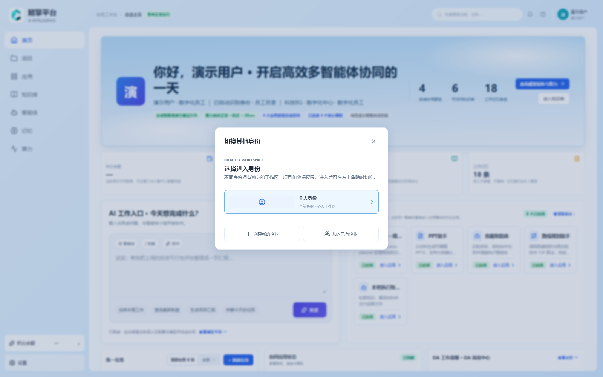
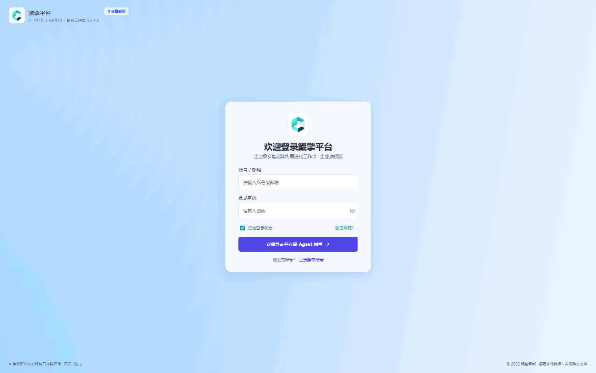
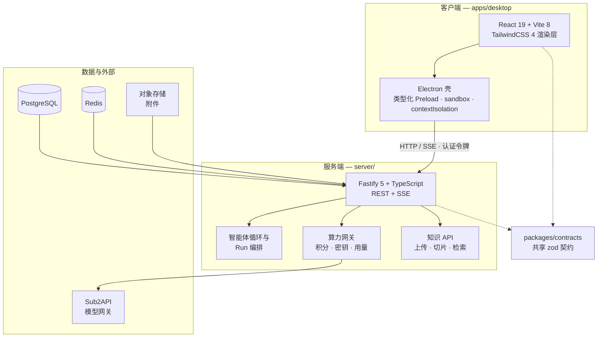

# KLA Workstation（鲲擎工作站）

**企业级多智能体协同工作站 —— 客户端 + 服务端。**

[](LICENSE)
[](https://nodejs.org)
[](https://pnpm.io)
[](https://www.typescriptlang.org)
[](.github/workflows/ci.yml)

<p align="center">
  
</p>

KLA Workstation 是一个企业级工作台：人与 AI 智能体在群聊、共享知识库和
多步骤长任务中协同工作。客户端是 **React + Vite 渲染层**加一个轻量、
安全加固的 **Electron 壳**；服务端是 **Fastify + TypeScript**，配
PostgreSQL 持久化与可插拔算力网关（sub2api 风格计费、API 密钥、用量跟踪）。

旗舰模块是 **三一战略规划协同**（SANY Strategic Planning）：完整的角色化
工作流——管理员把任务派发到业务单元，负责人准备材料、预填内容、处理缺口，
最终汇入经过校验与合并的公司级规划，每个字段都可追溯来源。

---

## ✨ 核心功能

### 协同
- **多智能体群聊**：创建项目、组建智能体群组，逐步观看执行轨迹（Run
  Event Log）与产出物。
- **智能体管理**：为智能体挂载模型、管理技能，统一查看服务端与本地执行
  工具。
- **长期记忆**：按身份、项目、群组范围浏览与沉淀记忆，服务端持久化。

### 知识
- **知识库**：个人 / 项目 / 企业三级范围，文件上传带异步解析进度，切片级
  阅读，统一的检索 API。
- **Excel 分析链**：纯 JS（exceljs）实现电子表格处理与 SVG 报告，无需
  Python 运行时。
- **PPT 助手**：确定性 `DeckSpec → PPTX` 引擎，打包为自包含智能体技能
  （离线、可审计、无外部渲染依赖）。

### 三一战略规划
- **双角色一平台**：管理员（集团战略管理部）与负责人（业务单元）共享
  上下文隔离的工作区。
- **全生命周期**：组织名册 → 公司层填报 → 校验 → 派发任务 → 负责人材料
  准备 → 内容预填 → 缺口处理 → 成果提交 → 汇总合并 → 公司级成果（六项
  交付检查）。
- **处处可溯源**：合并后的每个数字都回溯到已确认字段，每次提交都有版本
  记录，草稿按单元跟踪。

### 平台
- **算力与计费**：积分钱包、API 密钥管理、用量记录、模型广场，接入
  Sub2API 算力网关。
- **服务端权威安全**：账号、身份、权限、知识、记忆、角色定义只存服务端；
  渲染层只做缓存与草稿，不接触数据库与模型密钥。
- **本地工具 + 逐次审批**：Electron 壳暴露类型化的本地执行能力（读写文件、
  Shell 命令），每次调用弹窗审批，工作区根目录可配置，不开放入站端口。
- **Mock 模式**：整个技术栈可在内存服务器上运行（`demo@kla.local` /
  `demo123456`），零外部依赖。

---

## 🎬 演示

下面是对真实应用（mock server + Vite 开发服务器）的完整走查录像：登录、
首页总览、三一规划管理员流程（7 个页面）、负责人流程（4 个页面）、知识库
与算力仪表盘：



> 由真实开发构建录制（Chrome headless）。若 GIF 在你的阅读器中无法播放，
> 见 `docs/assets/` 下的静态截图。

---

## 🏗️ 架构



### Monorepo 结构

| 目录 | 说明 |
|---|---|
| `apps/desktop` | React + Vite 渲染层 + 轻量 Electron 壳（仅窗口与类型化 Preload） |
| `apps/points-admin` | 积分管理台（运营人员） |
| `server` | Fastify + TypeScript API：认证、项目、群聊、智能体、知识、记忆、算力 |
| `packages/contracts` | 共享 zod 契约与 API 类型 |
| `docs/` | 设计规格、交付计划、架构文档 |
| `deploy/` | Docker Compose、systemd 单元、环境变量模板 |

### 技术栈

| 层 | 技术 |
|---|---|
| 渲染层 | React 19、Vite 8、TailwindCSS 4、TanStack Query、lucide-react |
| 桌面壳 | Electron（contextIsolation、sandbox、无 nodeIntegration） |
| 服务端 | Fastify 5、TypeScript、pg、Redis、zod |
| 数据 | PostgreSQL 16、Redis 7、本地/对象存储 |
| 算力 | Sub2API 网关 + 积分计费 |
| 测试 | Vitest（单元 + 集成），74 个测试文件 |
| CI | GitHub Actions / GitLab CI：typecheck + lint + test + build |

---

## 🚀 快速开始

### 环境要求

- **Node.js** >= 22
- **pnpm**（`corepack enable pnpm` 或 `corepack prepare pnpm@11.9.0 --activate`）
-（可选）**Docker**，用于 PostgreSQL + Redis 开发栈

### 1. 安装

```bash
pnpm install
```

### 2a. Mock 模式（无数据库 —— 推荐首次体验）

```bash
# 终端 1 —— 内存服务器，端口 8787
pnpm --filter @kla-workstation/server exec tsx src/mock/mock-server.ts

# 终端 2 —— Vite 开发服务器，http://localhost:5173
pnpm dev
```

打开 `http://localhost:5173`，使用 **demo@kla.local / demo123456** 登录。
Mock server 复用生产路由注册与响应契约，数据保存在内存中，重启即重置。

### 2b. 完整模式（PostgreSQL + Redis）

```bash
# 启动 Postgres + Redis（服务端配置见 server/.env）
docker compose -f docker-compose.dev.yml up -d

pnpm dev:server    # http://127.0.0.1:8787，启动时自动执行迁移
pnpm dev           # http://localhost:5173
```

在登录页注册账号（邮箱 + 至少 8 位密码 + 昵称），注册即自动登录。

### Windows 一键预览

```bat
start-local-preview.bat
```

构建最新共享契约，启动前后端并打开 `http://127.0.0.1:5173/`。需要 Node
22+、pnpm 与 `server/.env`。可选参数：`-NoBrowser`、`-FrontendPort 5179`、
`-BackendPort 8788`。

### 运行桌面壳

```bash
pnpm --filter @kla-workstation/desktop desktop   # 构建 + Electron 壳
```

在 Electron 中热加载 Vite 页面（需先启动 Vite）：

```bash
# bash
KLA_RENDERER_URL=http://localhost:5173 pnpm --filter @kla-workstation/desktop exec electron .
```

---

## 🧪 验证

```bash
pnpm typecheck    # 全部包 TypeScript 类型检查
pnpm lint         # ESLint
pnpm test         # Vitest 单元 + 集成测试
pnpm build        # 全部包构建
pnpm ci-check     # 以上全部，按 CI 顺序
```

服务端集成测试在设置了 `DATABASE_URL` 时自动运行（未设置则跳过），因此
`pnpm test` 在 mock 环境下同样可用。

---

## 📁 项目结构（概览）

```
kla/
├── apps/
│   ├── desktop/         # React 渲染层 + Electron 壳
│   │   ├── src/
│   │   │   ├── api/     # HTTP 客户端适配器（认证、群聊、知识、三一规划…）
│   │   │   ├── features/ # 三一规划、知识模块
│   │   │   ├── workstation/ # 工作站主界面（首页、项目、群聊、算力）
│   │   │   └── …
│   │   └── desktop/     # Electron 主进程 + 类型化 Preload
│   └── points-admin/    # 积分管理台
├── server/
│   └── src/
│       ├── auth/        # 注册 / 登录 / 会话轮换
│       ├── routes/      # 项目、群聊、智能体、知识、记忆 API
│       ├── compute/     # 积分、额度、开通、网关
│       ├── mock/        # 无数据库内存服务器
│       └── …
├── packages/contracts/  # 共享 zod 契约
├── docs/                # 设计规格、交付计划、三一规划文档
└── deploy/              # docker-compose、systemd、环境变量模板
```

---

## 🗺️ 路线图

- [x] 服务端化拆分：认证、身份、权限、项目、群聊
- [x] 三一战略规划：管理员 + 负责人完整工作流（真实数据库）
- [x] 知识库：上传、异步解析、切片阅读、检索
- [x] 算力网关：积分、API 密钥、用量记录、模型广场
- [x] 长期记忆与范围化记忆浏览界面
- [x] Mock server：零依赖开发模式
- [ ] Redis 作业队列与限流（已接线占位）
- [ ] 对象存储跨设备协作（路径已接线）
- [ ] 客户端迁移：全部页面收敛 `window.kunqing` 旧桥接
- [ ] 分布式智能体运行时（设计阶段：`docs/DISTRIBUTED_AGENT_RUNTIME.md`）

---

## 📖 文档

- [完整前后端技术落地规格](docs/FULL_STACK_IMPLEMENTATION_SPEC.md)
- [API 契约索引与冻结流程](docs/API_CONTRACTS.md)
- [客户端/服务端拆分边界](docs/CLIENT_SERVER_SPLIT.md)
- [下一版本 MVP：需求](docs/NEXT_VERSION_MVP_REQUIREMENTS.md)
- [开发交付计划](docs/DEVELOPMENT_DELIVERY_PLAN.md)
- [部署指南（CentOS 7 裸金属）](docs/DEPLOY_CENTOS7_BARE_METAL.md)
- [Sub2API 算力平台设计](docs/DESIGN_SUB2API_COMPUTE_PLATFORM.md)

---

## 🤝 贡献

欢迎贡献。请先阅读 [CONTRIBUTING.md](CONTRIBUTING.md)——涵盖分支模型、
`pnpm ci-check` 门禁与 API 契约冻结流程。

## 📄 许可证

[MIT](LICENSE)。仓库内附带的第三方组件遵守其各自许可证（vendored 的 PPT
运行时与保留在树内的 `node_modules` 按原始许可证分发）。
