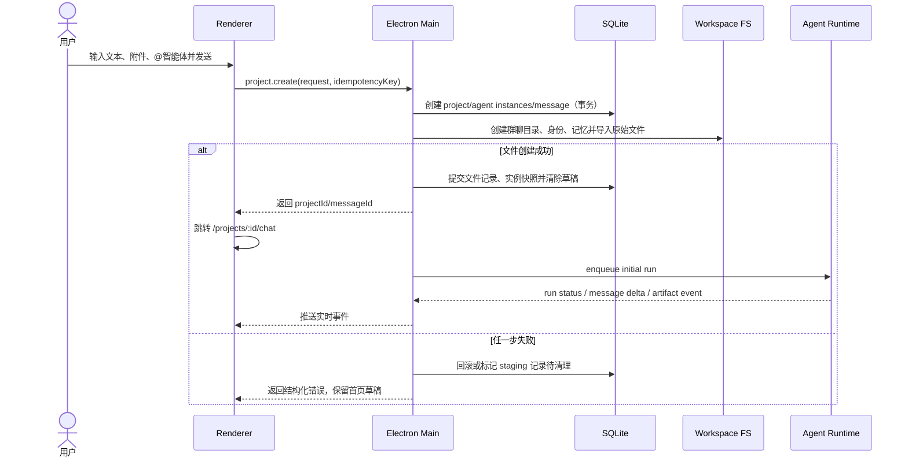
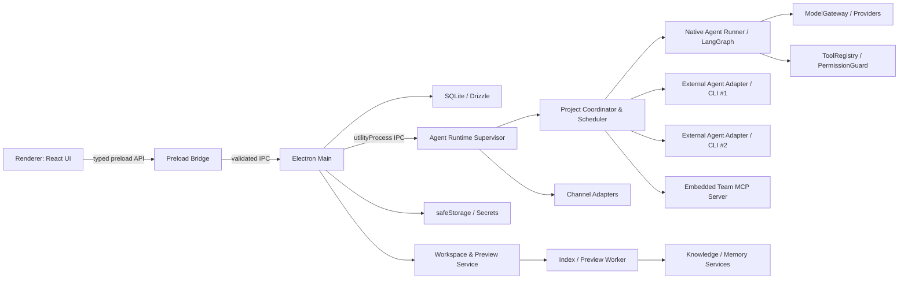

# 鲲擎多智能体集成工作站 MVP 开发规格

> **历史基线说明**：本文档记录 2026-07-18 的 MVP 设计与验收基线，不是当前实现的唯一规范。当前目录、工作区边界、智能体职责和已上线页面以 [ARCHITECTURE.md](ARCHITECTURE.md) 及代码为准；文中与当前实现冲突的功能开关或目录约定仅用于兼容和追溯。

> 文档版本：1.1  
> 状态：Implementation Baseline（可直接进入开发）  
> 日期：2026-07-18  
> MVP 范围：首页、群聊、工作区、设置  
> 明确不在本期：会议页面、任务中心、OA 审批闭环、SSO/LDAP、移动 WebUI

## 1. 文档目的与效力

本文档将产品 PRD、前端功能说明和 Figma UI 稿统一为一份可编码、可测试、可验收的 MVP 基线。后续编码智能体不应再自行推断核心架构、路由、数据结构或调度规则。

信息冲突时按以下优先级执行：

1. 本文档定义的 MVP 范围、业务规则、数据模型和接口契约。
2. Figma 节点定义的视觉结构、比例和内容层级。
3. `multi_agent_cowork_PRD_v2.html` 中的产品目标与非功能要求。
4. `鲲擎工作站前端UI-1.0功能说明.docx` 中的交互补充。

Figma 参考节点：

| 页面 | 节点 | 参考尺寸 |
|---|---|---:|
| 首页 | [30:4824](https://www.figma.com/design/1WYOpJREbWfx3mUXtCOrjZ/Untitled--Copy-?node-id=30-4824) | 1906 × 1024 |
| 群聊详情与成果预览 | [28:2912](https://www.figma.com/design/1WYOpJREbWfx3mUXtCOrjZ/Untitled--Copy-?node-id=28-2912) | 2148 × 1061 |
| 工作区 | [29:4092](https://www.figma.com/design/1WYOpJREbWfx3mUXtCOrjZ/Untitled--Copy-?node-id=29-4092) | 1700 × 1000 |
| 设置—智能体 | [4:2084](https://www.figma.com/design/1WYOpJREbWfx3mUXtCOrjZ/Untitled--Copy-?node-id=4-2084) | 1840 × 1005 |
| 设置—远程连接 | [4:1782](https://www.figma.com/design/1WYOpJREbWfx3mUXtCOrjZ/Untitled--Copy-?node-id=4-1782) | 1951 × 1005 |

v1.1 补充：K_Studio 大工作区目录契约、群聊身份/记忆/原始文件/知识图谱/Wiki/可视化、共享知识、两个内置智能体、LangGraph/ModelGateway 技术选型、模型与 CLI Agent 接入和对应测试基线。

## 2. 已固定的产品决策

### 2.1 核心术语

- **协作项目（Project）**：领域聚合根，包含一个主群聊、工作区、智能体成员、消息和执行记录。
- **群聊（Chat）**：项目的人机交互界面。MVP 中一个项目只有一个主群聊，不单独建立 `chats` 表。
- **主智能体（Leader Agent）**：项目默认接收者，可直接回答或通过 Team MCP 工具委派子任务。
- **子智能体（Teammate Agent）**：被主智能体委派，或被用户通过 `@` 直接调用。
- **内部执行任务（Agent Run）**：一次可排队、运行、取消、失败或完成的智能体调用。它是运行时对象，不等于本期不实现的“任务中心”。
- **K_Studio 大工作区（Studio Workspace）**：用户选择或应用创建的本地根目录，承载应用数据库、智能体预制定义、全部群聊目录和共享知识。
- **群聊工作区（Group Workspace）**：`K_Studio/group-chats/<groupId>/`，只对对应群聊生效，保存身份、记忆、原始文件、知识、图谱可视化和成果。
- **共享知识（Shared Knowledge）**：`K_Studio/shared-knowledge/`，默认可被所有群聊检索，但每个群聊可关闭共享知识访问。
- **智能体定义（Agent Definition）**：版本化的模板，声明身份、框架入口、技能、模型能力要求和最大权限，不保存具体项目记忆。
- **智能体配置（Agent Profile）**：用户在设置中创建的全局可选智能体，绑定定义、运行模式和模型/CLI 连接。
- **智能体实例（Agent Instance）**：某个 Agent Profile 加入群聊后的隔离实例，拥有该群聊专属身份快照和记忆目录。
- **成果（Artifact）**：与消息关联的文件；同一路径被再次生成时新增版本，不覆盖历史版本。

### 2.2 导航与范围

- 全局导航保留：首页、项目、会议、任务、设置。
- 首页、项目、设置可用；会议、任务显示“即将上线”并禁用，不创建空白路由和伪实现。
- Figma 中的“项目”即本文档的协作项目；用户口语中的“群聊”指项目详情中的聊天界面。
- “New Chat”创建的是协作项目，不创建无工作区的临时聊天。
- MVP 为单机单用户产品，不实现登录、组织、角色和成员权限；数据库中保留 `actor_type` 等扩展字段。

### 2.3 与 AionUI 的关系

产品概念和接入方式延续 AionUI 的本地优先、CLI Agent 与远程渠道思路，但当前工作区没有 AionUI 源码，MVP 不把未经审计的上游仓库作为隐式依赖：

- 前端按本文档与 Figma 独立实现，不复制上游整套 UI。
- Aion CLI 作为一个标准 `AgentAdapter` 接入，与 Codex/Claude/Gemini/Qwen 等适配器同层。
- 如果开发期引入 AionUI 代码，必须先记录上游 commit、许可证、修改范围和安全审计结果，再以独立 package 方式复用。
- 不允许直接修改 `node_modules` 或依赖未固定的远程主分支。

### 2.4 MVP 功能边界

| 模块 | 本期包含 | 本期不包含 |
|---|---|---|
| 首页 | 文本草稿、附件、`@` 智能体、模板卡片、原子化创建项目 | 语音转写、模板市场 |
| 群聊 | 项目列表、消息流、流式响应、运行状态、直接路由、Leader 委派、成果预览、取消/重试 | 消息多人已读、人工审批卡片、任务中心联动 |
| 工作区 | K_Studio 初始化、群聊隔离目录、共享知识、原始文件、记忆、知识图谱、Wiki、图谱可视化、文件操作与版本化 | 云盘同步、多人权限、Office 在线编辑 |
| 内置智能体 | 统筹管理智能体、知识管理智能体；模型可替换；技能和权限强制执行 | 在线智能体市场、用户上传任意可执行 Agent 代码 |
| 设置 | 模型 Provider/Profile、内置 Agent Profile、CLI Agent、能力权限、外观、远程连接、系统、关于 | 技能市场、SSO、企业级审计后台 |
| 远程连接 | Telegram、飞书/Lark、钉钉；企业微信群机器人仅出站 | 个人微信；企业微信自建应用双向会话 |
| 全局能力 | 本地搜索、通知、主题、日志、诊断 | 云端账号同步、移动端 |

语音按钮由 `features.voiceInput=false` 控制，默认不渲染。会议与任务导航由 `features.meetings=false`、`features.taskCenter=false` 控制，默认显示禁用态。

## 3. 关键用户流程

### 3.1 从首页创建协作项目



项目默认名称规则：取首条消息去除换行后的前 24 个可见字符；内容为空时使用 `新对话 - YYYY-MM-DD HH:mm`。名称允许后续手动修改。

### 3.2 消息路由

1. 未指定 `@`：只创建主智能体运行；主智能体可自行委派子智能体。
2. `@` 一个子智能体：只调用该子智能体，不通知主智能体。
3. `@` 多个子智能体：分别创建独立运行，可并行执行；系统不自动汇总，除非同时 `@` 主智能体。
4. 同一智能体同一时间只执行一个 Run；后续 Run 按创建时间 FIFO 排队。
5. 不同智能体受全局并发限制，默认 4、可配置 1–16。
6. 委派深度最多 2 层；禁止循环委派给祖先运行；每条用户消息最多产生 20 个 Run。
7. Agent Run 的真实状态必须展示，禁止用纯前端定时器伪造进度。

### 3.3 成果文件闭环

1. 智能体在当前项目工作区内创建或修改文件。
2. 文件监视器忽略临时文件并在 500 ms 稳定窗口后计算 SHA-256。
3. 新路径创建 `files` 与首个 `file_versions`；已有路径且哈希变化时新增版本。
4. 系统写入成果消息并关联 `file_id`、`version_id`、`run_id`。
5. 用户点击成果消息后在右侧预览；工作区同步出现该文件。
6. 智能体不得把工作区外路径作为成果发布。

## 4. 页面与交互规格

### 4.1 全局应用壳

路由：

```text
/
/projects/:projectId/chat
/projects/:projectId/workspace
/settings/agents
/settings/models
/settings/assistants
/settings/capabilities
/settings/appearance
/settings/channels
/settings/system
/settings/about
```

固定结构：

- 全局侧栏：参考宽度 240 px，包含品牌、主导航、New Chat、设置、个人中心。
- 顶栏：高度 64 px，包含页面标题、全局搜索、通知、帮助、头像。
- `Ctrl/Cmd+K` 打开全局搜索；搜索项目、消息、文件、智能体和设置项。
- `Ctrl/Cmd+N` 聚焦首页输入框；若当前有未发送内容，先保存草稿再跳转。
- `Esc` 依次关闭弹窗、搜索、预览抽屉。
- 单用户头像菜单仅提供“本地个人信息”“打开日志目录”“退出应用”，不出现假登录流程。

窗口支持最小 1280 × 720；推荐 1920 × 1080。窗口宽度不足时：

- `< 1600`：全局侧栏折叠为 88 px，只显示图标。
- `< 1440`：项目列表可手动收起；成果预览改为右侧覆盖抽屉。
- `< 1280`：不再压缩核心聊天区，显示最小窗口尺寸提示。

### 4.2 首页 `/`

视觉基线：Figma `30:4824`。

- 主内容从 64 px 顶栏下方开始，参考最大宽度 1440 px。
- Hero 标题“鲲擎智汇，由你开启”，参考字号 48/56；副标题 16/24。
- 中央输入卡参考宽 768 px、高 211 px、圆角 16 px；文本区自动增长至 160 px。
- 下方为 4 列推荐项目卡；窗口变窄时变为 2 列，卡片最小宽 280 px。
- 首页输入状态包含：文本、结构化 mention、待导入附件、所选模板和提交状态。
- 草稿每 500 ms 防抖持久化；成功创建后清空，失败保留。
- 附件先进入应用临时目录；创建成功后由 Main 进程移入项目工作区。
- 输入为空且无附件时发送按钮禁用；提交中禁止重复发送。
- 输入 `@` 弹出可用智能体列表；首页 mention 保存 Profile ID，群聊 mention 保存 Instance ID，不能依靠显示名称解析。
- 点击推荐卡使用模板预设的主智能体、成员和首条提示创建项目；模板来自内置 JSON，不联网。
- 首页模板种子：财务审计协同、市场调研小组、智能研发协作、创意营销工坊。

验收：

- `AC-HOME-01`：重启应用后未发送草稿仍存在。
- `AC-HOME-02`：连续双击发送只产生一个项目，依赖 idempotency key 保证。
- `AC-HOME-03`：创建失败时不跳转、不丢草稿，并显示可重试错误。
- `AC-HOME-04`：创建成功后，项目、工作区、成员、首条消息和附件均可查询。
- `AC-HOME-05`：无 mention 时主智能体自动加入；有 mention 时主智能体仍作为 Leader 加入，但首轮只按路由规则触发。
- `AC-HOME-06`：新群聊同时生成统筹与知识管理实例的合法 IDENTITY/记忆目录；知识管理实例不会因普通首条消息自行回复。

### 4.3 群聊 `/projects/:projectId/chat`

视觉基线：Figma `28:2912`。

参考布局：

- 全局侧栏 240 px。
- 项目列表 320 px，头部 77 px；按 `last_active_at DESC` 排序。
- 中间聊天区最小 560 px、弹性伸展；聊天标题栏 64 px。
- 右侧成果预览参考 600 px；无选中文件时显示项目摘要与最近成果。
- 消息正文最大宽 896 px；消息量大时使用虚拟列表，但必须保持底部锚定和历史加载位置。
- 输入区底部固定，高度 64–165 px；支持多行、附件、mention、取消运行。

项目列表项显示：状态标签、名称、最近消息摘要、最近时间、未读/运行提示、最多 3 个智能体头像。MVP 状态为 `active | reviewing | archived`，归档项目只读，可恢复。

消息类型：

```ts
type MessageKind =
  | 'text'
  | 'system'
  | 'run-status'
  | 'artifact'
  | 'warning';
```

消息交互：

- 用户消息写入数据库成功后立即显示，再触发运行。
- 智能体流式文本以 100 ms 或 1 KB 为批次刷新 UI，数据库最多每 250 ms 合并写入一次。
- 流式中断时消息标记 `interrupted`，允许“重试”；重试创建新 Run，不覆盖旧记录。
- 每个 Agent Run 展示排队、运行、已完成、失败、已取消状态。
- 支持复制、引用回复、重试失败运行；MVP 不实现消息编辑和删除。
- 消息内 Markdown 使用 GFM；代码块高亮；原始 HTML 必须转义。
- 风险/警告消息使用危险色，但不等同于审批流程。
- 点击成果消息打开右侧预览，并将 `fileId/versionId` 写入 URL 查询参数，便于恢复。
- 切换项目时保存各自滚动位置、输入草稿和当前预览文件。

验收：

- `AC-CHAT-01`：无 `@` 消息仅触发 Leader；直接 `@` 子智能体不触发 Leader。
- `AC-CHAT-02`：同一 Agent 的两次请求严格 FIFO，不同 Agent 可并行。
- `AC-CHAT-03`：关闭并重启应用后，未完成 Run 被标记 `interrupted`，不会悄悄显示完成。
- `AC-CHAT-04`：取消运行在 2 秒内进入 `cancelling/cancelled`；无法优雅退出时终止子进程树。
- `AC-CHAT-05`：1 万条消息下历史分页与滚动可用，首次只读取最新 50 条。
- `AC-CHAT-06`：智能体生成文件后，聊天成果消息、工作区文件和版本记录一致。

### 4.4 工作区 `/projects/:projectId/workspace`

视觉基线：Figma `29:4092`。

- 左侧保持 320 px 项目列表，当前项目高亮。
- 主区顶部 64 px，包含 scope 切换（当前群聊/共享知识）、面包屑、上传文件、新建文件夹。
- 文件表列：名称、来源、大小、最后修改、操作。
- 当前群聊根目录以业务名称展示：智能体身份、智能体记忆、原始文件、知识、图谱可视化、成果；映射到第 11 节固定目录，不能由用户重命名或移动系统目录。
- “共享知识”切换到 `K_Studio/shared-knowledge`，显示原始文件、知识和图谱可视化；共享 scope 中不显示某个群聊的身份、记忆或 outputs。
- 单击选择；双击文件打开预览；双击文件夹进入；多选后显示悬浮操作条。
- 支持名称、大小、更新时间排序；默认“文件夹优先 + 更新时间降序”。
- 支持批量导入，单文件上限 100 MB；总批次默认上限 500 MB。上传按钮只在 `original-files` 及其用户子目录可用；从其他系统目录点击上传时自动切换到原始文件并提示目标位置。
- 文件夹名和文件名不得为空，不得包含 Windows 保留名、路径分隔符或控制字符。
- 重命名和移动必须做目标冲突检查；不允许移入自身或子目录。
- 删除采用软删除：移动到当前 scope 的 `.runtime/trash` 并标记 `deleted_at`；30 天后清理。本期不提供回收站 UI，但保留恢复服务接口。
- 工作区变更由文件监视器同步；应用自身操作写入 `operation_id`，避免 watcher 重复生成版本。
- 原始文件行显示知识状态：待入库、处理中、已入库、需复核、失败、过期；点击状态打开 Job 详情和来源图谱统计。
- `current.graph.json` 使用图谱专用预览器；节点可回溯原文件版本和页码/段落。

预览矩阵：

| 格式 | 实现 | 限制 |
|---|---|---|
| txt/md/json/csv/log | 文本读取；Markdown 用 `react-markdown` | 文本预览最大 10 MB |
| html/htm | DOMPurify 清洗后放入无脚本 sandbox iframe | 禁止脚本、网络和顶级导航 |
| pdf | 自定义 `app-file://` 只读协议 + Chromium PDF viewer | 最大 100 MB |
| png/jpg/jpeg/gif/webp/svg | 图片预览；SVG 清洗 | 最大 50 MB |
| docx | `mammoth` 转 HTML 后清洗 | 不保证复杂版式完全一致 |
| xlsx/xls | `xlsx` 只读解析，按工作表分页 | 单表最多渲染 5 万单元格 |
| `current.graph.json` | Cytoscape.js 专用图谱预览 | 默认最多渲染 2000 节点，更多结果按查询/类型展开 |
| doc/其他 | 显示元数据并允许系统外部打开 | 不做内嵌预览 |

验收：

- `AC-WS-01`：不同项目的文件路径和索引完全隔离。
- `AC-WS-02`：相同文件再次修改产生新版本，旧版本仍可打开和下载。
- `AC-WS-03`：`..`、绝对路径、符号链接越界均被 Main 进程拒绝。
- `AC-WS-04`：HTML/SVG 预览不能执行脚本或访问 `file://`、Node API。
- `AC-WS-05`：用户通过文件对话框导入，Renderer 不能提交任意本地绝对路径执行文件操作。
- `AC-KS-01`：首次启动创建完整 K_Studio marker、数据库、预制定义、群聊根和共享知识根；中途失败不会留下可被误判为有效的半初始化工作区。
- `AC-KS-02`：群聊 A 的身份、记忆、原始文件和知识不能被群聊 B 的普通检索读取；共享知识开启时两者都能读取带 shared 标签的结果。
- `AC-KS-03`：首页、聊天和工作区三种上传入口最终都把用户文件写入对应 `original-files`，不会写入 knowledge 或 Agent 定义目录。
- `AC-KS-04`：关闭共享知识后，新建 ContextSnapshot 不包含任何 shared 命中。
- `AC-KG-01`：图谱的每个节点和边都能回溯到 fileVersion/chunk/location；无来源候选不会进入主图。
- `AC-KG-02`：同一文件版本重复入库不重复调用模型，图谱与 Wiki checksum 保持不变。
- `AC-MEM-01`：短期记忆过期后不进入新 Run 上下文；长期记忆仍可读且可由用户删除。

### 4.5 设置

视觉基线：Figma `4:2084`、`4:1782`。

设置页面在全局侧栏右侧增加 220 px 二级导航。MVP 固定为四个入口，顺序不能变化：

1. 智能体接入（默认选中）。
2. 模型管理。
3. 渠道。
4. 算力（禁用并显示“即将上线”，不注册可达路由）。

助手 Profile 与能力扩展在 MVP 仍沿用本节的数据模型和服务，不提供独立二级入口；外观、系统和关于延后到设置扩展版本。

#### 4.5.1 智能体

页面分为“内置智能体”“CLI 智能体”“自定义配置”三个筛选视图。

内置智能体：

- 安装时写入统筹管理智能体和知识管理智能体定义；定义文件版本化且带 SHA-256 校验。
- 卡片显示定义版本、运行框架、当前模型 Profile、技能、有效权限、测试状态和被多少群聊使用。
- 用户可更换兼容模型、关闭非必需技能、收紧权限、克隆为自定义 Profile；不能把权限扩大到定义声明的最大权限之外。
- 统筹管理智能体是默认 Leader；知识管理智能体默认加入新群聊但不响应普通消息，只响应明确 `@`、Leader 委派或知识入库事件。
- 修改全局 Profile 只影响之后新建的群聊；已有群聊实例默认固定快照，用户可在群聊设置中显式升级。

CLI 智能体：

- 启动时和用户点击刷新时检测 CLI，不全盘扫描；范围为 PATH、用户显式选择的可执行文件和适配器声明的已知安装目录。
- 内置适配器：Aion CLI、Claude Code、Codex CLI、Gemini CLI、Qwen Code；Auggie、CodeBuddy 只有在实现并测试对应策略后才显示可用。
- 状态：`available | unavailable | checking | busy | error | disabled | incompatible`。
- 接入向导固定步骤：选择/检测可执行文件 → 读取版本 → 选择版本兼容策略 → 检查 CLI 自身认证 → 在临时群聊工作区运行无副作用测试 → 展示能力与风险 → 保存。
- CLI 登录凭据由 CLI 自身管理；应用不读取其 OAuth token、Cookie 或全局配置中的密钥。
- 用户可选择“复用 CLI 当前认证”或“仅传入 K_Studio 密钥引用”。后者只有适配器明确支持环境变量认证时可用。
- 自定义智能体必须分别填写可执行文件和 argv 数组；禁止保存一整段 shell 命令。
- 可配置显示名、协议策略、路径、参数、超时、是否可委派、工作区访问模式和环境变量密钥引用。
- `cwd` 不是安全沙箱。任意外部 CLI 必须标记为“受信任的本地程序”；MVP 不宣称能阻止它读取当前 OS 用户可访问的其他文件。
- 结构化协议、版本探测和临时 MCP 注入参数必须按 CLI 版本保存在适配器策略中，并由契约测试验证，禁止在业务代码中散落命令行 flags。

智能体 Profile 与群聊实例：

- 一个 Profile 的运行模式为 `native-model | external-cli` 二选一。
- `native-model` 绑定兼容的 Model Profile，使用内置 LangGraph 工作流和受控工具。
- `external-cli` 绑定 CLI Connection，使用对应 CLI 自身的模型与认证，不出现在“模型”下拉框中。
- 用户可以为内置智能体更换 Model Profile；也可以用 CLI Agent 替换群聊中的同一角色，但后者属于替换整个运行后端，不保证继续执行原 LangGraph 工作流，UI 必须展示能力差异。
- 每个群聊恰好一个 Leader；系统默认 Leader 用于新建群聊。
- API Key 和 Token 只保存为密钥引用，不写入普通配置或 Agent 定义文件。

#### 4.5.2 模型管理（助手与能力扩展暂不提供独立入口）

模型页区分 Provider Connection 与 Model Profile：

- Provider Connection 保存供应商类型、Base URL、认证方式、密钥引用、网络代理引用和状态，不绑定具体智能体。
- MVP Provider：OpenAI、Anthropic、Google Gemini、OpenAI-compatible、自托管 Ollama/vLLM（通过兼容端点）。
- Model Profile 保存 Provider、模型 ID、显示名、参数、上下文长度声明和已验证能力。
- 接入流程：选择 Provider → 填写端点与认证 → 测试连通性 → 拉取或手填模型 ID → 依次测试流式文本、工具调用、结构化输出 → 保存能力报告。
- 模型列表接口不可用时允许手填 ID，但不能凭模型名称猜测能力；只有测试通过的能力进入 `verifiedCapabilities`。
- 不在代码中硬编码“最新模型”。默认模型来自用户配置或安装时种子配置，运行前必须存在且测试通过。
- 定义模型槽位 `reasoning`、`fast`、`embedding`。内置智能体绑定槽位而不是供应商模型名；全局槽位可映射到不同 Profile。
- 群聊 Agent Instance 可固定具体 Model Profile。未固定时，每次 Run 解析当前槽位映射，因此可无损替换供应商或模型。
- 替换前检查智能体定义的能力要求；统筹管理智能体要求 `streaming + toolCalling + structuredOutput`，知识管理智能体要求 `structuredOutput`，缺失能力时禁止保存。

助手页实际管理 Agent Profile，不再创建另一套与 Agent 重复的数据模型：

- 用户可编辑显示名、描述、身份补充、默认模型/CLI、技能开关和权限收缩项。
- 预制 Profile 可克隆，不能直接修改应用签名的定义源文件。

能力扩展页：

- 本期管理内置 Skill、Tool 和 MCP Server 配置，不实现在线市场。
- 内置能力包括 Team 委派、群聊文件检索、共享知识检索、记忆读写、知识入库、图谱查询和成果发布。
- Skill 是提示与流程说明；Tool 是受代码权限控制的可执行能力。Skill 声称的权限不能越过 ToolRegistry 的授权检查。

#### 4.5.3 外观与系统

- 外观：亮色、暗色、跟随系统；简体中文为默认语言，保留英文资源结构。
- 系统：当前 K_Studio 根目录、打开目录、完整性检查、迁移/备份、全局 Agent 并发数、日志级别、开机启动、导出诊断包、清理缓存。
- 更换 K_Studio 使用“复制并校验 → 切换 pointer → 重启”的迁移流程；不能在运行中直接把数据库指向另一目录，也不能只移动某个群聊子目录。
- “修复工作区”只能重建索引和物化投影，不自动覆盖用户原始文件、Identity、Memory 或自定义定义。
- 关于：版本、构建号、Electron/Chromium/Node 版本、开源许可。

#### 4.5.4 远程连接

远程连接 UI 按 Figma 分为渠道列表、实时概览和最近活动。适配器能力：

| 渠道 | MVP 模式 | 凭据 | 备注 |
|---|---|---|---|
| Telegram | Bot long polling，双向 | Bot Token | 无需公网 webhook |
| 飞书/Lark | WebSocket 长连接，双向 | App ID、App Secret | 需用户在开放平台启用事件 |
| 钉钉 | Stream 模式，双向 | Client ID、Client Secret | 无需公网回调 |
| 企业微信群机器人 | Webhook，仅出站 | Webhook URL、可选签名 | UI 标签使用“企业微信群机器人” |
| 个人微信/企业微信自建应用 | 不实现 | — | 禁用并显示“即将上线” |

远程消息规则：

- 外部会话通过 `channel_bindings` 映射到项目。
- 未绑定会话的第一条普通消息只返回隐私提示和确认按钮/命令，不创建项目；用户明确确认或发送 `/new` 后才创建并绑定。
- 支持命令：`/new`、`/projects`、`/use <shortId>`、`/stop`、`/status`。
- 外部附件先下载到隔离临时目录，校验大小和 MIME 后再导入项目。
- 外部渠道发送的消息遵循相同 Agent 路由和并发规则。
- 渠道密钥使用安全存储；日志中必须脱敏；连续失败采用指数退避，最大 5 分钟。

验收：

- `AC-SET-01`：CLI 检测、测试和保存均返回明确状态与错误原因。
- `AC-SET-02`：Renderer、数据库明文字段和日志中均找不到密钥原文。
- `AC-SET-03`：禁用智能体后不能被新请求或 Leader 委派，但历史消息仍可读。
- `AC-SET-04`：主题切换实时生效，重启后保留。
- `AC-MODEL-01`：只通过文本生成测试、未通过工具调用测试的模型不能绑定统筹管理智能体。
- `AC-MODEL-02`：把内置智能体从 Provider A 的模型切换到兼容的 Provider B 后，无需修改智能体定义即可运行。
- `AC-AGENT-01`：内置 Agent Profile 的权限只能收紧，无法在 UI 或 IPC 中越过定义的最大权限。
- `AC-AGENT-02`：CLI 版本不在已测试范围时标记 incompatible/experimental，不能静默使用其他版本策略。
- `AC-AGENT-03`：Codex 等 CLI 的认证信息不被应用读取或复制，测试日志中不出现 CLI 全局配置内容。
- `AC-CHANNEL-01`：渠道启用前必须测试通过；失败不进入启用态。
- `AC-CHANNEL-02`：同一个远程事件重复投递只生成一条消息。

## 5. 视觉系统

Figma 未提供可读取的变量集合，以下 Token 由五个节点的实际颜色和尺寸归一化而来，编码时必须先落地为 CSS Variables/Tailwind theme，禁止页面散落硬编码颜色。

```css
:root {
  --kq-bg: #f9f9fe;
  --kq-surface: #ffffff;
  --kq-surface-muted: #f3f3f8;
  --kq-surface-subtle: #ededf2;
  --kq-text: #1a1c1f;
  --kq-text-secondary: #464554;
  --kq-text-tertiary: #777586;
  --kq-primary: #4441cc;
  --kq-primary-hover: #5e5ce6;
  --kq-border: #e2e2e7;
  --kq-border-strong: #c7c4d7;
  --kq-success: #006424;
  --kq-success-bg: #72fe88;
  --kq-danger: #ba1a1a;
  --kq-danger-bg: #ffdad6;
  --kq-info: #005572;
  --kq-info-bg: #60cdff;
  --kq-radius-tag: 4px;
  --kq-radius-control: 8px;
  --kq-radius-card: 12px;
  --kq-radius-composer: 16px;
  --kq-header-height: 64px;
  --kq-global-sidebar-width: 240px;
  --kq-project-sidebar-width: 320px;
  --kq-settings-sidebar-width: 220px;
}
```

- 默认字体：`Inter, "PingFang SC", "Microsoft YaHei", system-ui, sans-serif`。
- 正文字号 14/20；辅助文字 12/18；页面标题 24/32 或 32/40；首页 Hero 48/56。
- 卡片阴影只使用两级：`0 1px 2px rgba(0,0,0,.05)`、`0 10px 25px rgba(0,0,0,.10)`。
- 所有交互元素必须具备 hover、focus-visible、disabled、loading 和 error 状态。
- 颜色不是唯一状态信号；状态必须同时有文字或图标。
- 普通文本与背景对比度至少 4.5:1；键盘焦点可见。

## 6. 技术栈与架构决策

### 6.1 固定技术栈

| 层 | 选择 | 说明 |
|---|---|---|
| 桌面容器 | Electron + electron-vite | CLI/PTY、文件系统和 Windows 桌面能力成熟 |
| 语言 | TypeScript strict | Main、Preload、Renderer、Runtime 共用契约 |
| 前端 | React、React Router、Tailwind CSS、Radix UI | Figma 参考代码只用于还原，不直接复制绝对定位代码 |
| 前端状态 | TanStack Query + Zustand | 服务端/本地异步状态与纯 UI 状态分离 |
| 列表 | TanStack Virtual | 长消息流和大文件列表 |
| 内置 Agent 工作流 | LangGraph.js | 显式状态图、节点重试、可测试的统筹与知识处理流程 |
| 模型网关 | 自有 `ModelGateway` + Vercel AI SDK Core Provider 适配器 | 统一流式、工具调用和结构化输出，隔离供应商差异 |
| Skill/Tool | Markdown/YAML Skill + Zod ToolRegistry | Skill 提供流程说明；Tool 通过代码强制权限 |
| 数据库 | SQLite WAL + Drizzle ORM + better-sqlite3 | 本地单机、迁移可控、支持 FTS5 |
| 知识图谱 | SQLite 节点/边表 + JSONL/Markdown 投影 | 无独立图数据库，便于本地迁移、测试和人工检查 |
| 图谱可视化 | Cytoscape.js | Renderer 内交互式图谱、筛选、布局和导出 |
| 校验 | Zod | IPC 两端、配置、适配器事件统一校验 |
| CLI 进程 | `child_process.spawn` + `node-pty` | 结构化进程优先；仅交互 CLI 使用 PTY |
| 文件监视 | chokidar | 识别智能体在工作区产生的文件 |
| 日志 | pino + rotating file transport | JSON 日志、脱敏、滚动 |
| 测试 | Vitest + Testing Library + Playwright Electron | 单元、集成、端到端、视觉回归 |
| 打包 | electron-builder（Windows NSIS） | 处理 native modules 重建与安装包 |
| Monorepo | pnpm workspace | 共享 contracts、database、agent、ui 包 |

版本策略：初始化时选用当日稳定版本并锁定精确版本；提交 `pnpm-lock.yaml`。不得使用 `latest` 浮动依赖。Node 运行版本与 Electron 内置 Node ABI 不同的 native module 必须在打包前执行重建。

### 6.2 为什么使用 Electron

本产品的核心不是普通网页，而是本地 CLI 调度、PTY、文件监控、工作区隔离、系统托盘和安全密钥。Electron 能直接使用 Node 生态并减少跨语言桥接。代价是安装包体积较大；MVP 接受该代价，首要目标是可靠实现 Windows 桌面协作闭环。

### 6.3 进程边界



职责：

- **Renderer**：只负责展示、表单、路由和短期 UI 状态；不能访问 Node、文件路径、数据库和进程。
- **Preload**：只暴露白名单、强类型的业务 API；不暴露原始 `ipcRenderer`。
- **Main**：唯一数据库写入者；负责窗口、文件、密钥、对话框、IPC、事件持久化和 Runtime 生命周期。
- **Agent Runtime**：独立 `utilityProcess`，负责内置 LangGraph Agent、ModelGateway、CLI、PTY、Team MCP、队列、渠道长连接；崩溃不应带崩桌面 UI。
- **Worker**：处理大文件哈希、文本抽取、知识入库确定性阶段和预览转换，避免阻塞 Main。

MVP 不启动对外 REST 服务。Renderer 与 Main 只通过 Electron IPC；Team MCP 仅绑定 `127.0.0.1` 的随机端口并使用每次启动生成的 bearer token，或由支持的适配器使用 stdio。

### 6.4 安全基线

BrowserWindow 必须设置：

```ts
{
  contextIsolation: true,
  nodeIntegration: false,
  sandbox: true,
  webSecurity: true,
  allowRunningInsecureContent: false
}
```

- 生产环境 CSP 默认 `default-src 'self'`；按预览和开发需要最小化放行。
- 禁止 Renderer 使用 `file://`；文件通过只读 `app-file://` 协议按 file/version ID 访问。
- 禁止通过 `shell: true` 执行 Agent；必须传 executable 与 argv 数组。
- 打开外部 URL 前只允许 `https:`，并显示域名确认；禁止 `javascript:`、`data:`。
- Agent 子进程只继承环境变量白名单和该 Agent 的密钥引用。
- Windows 退出/取消时用 Job Object 等价机制或进程树终止方案，避免遗留 CLI。

## 7. 仓库结构

```text
.
├─ apps/
│  ├─ desktop/
│  │  ├─ src/main/          # Electron Main、IPC handlers、protocols
│  │  ├─ src/preload/       # typed bridge
│  │  └─ src/renderer/      # React UI
│  └─ runtime/
│     └─ src/               # Agent supervisor、scheduler、Team MCP、channels
├─ packages/
│  ├─ contracts/            # Zod schemas、DTO、event types、error codes
│  ├─ database/             # Drizzle schema、migrations、repositories
│  ├─ model-core/           # ModelGateway、Provider adapters、能力探测
│  ├─ native-agent-core/    # LangGraph 内置 Agent、Skill/Tool registry
│  ├─ agent-core/           # adapters、routing、queue、context builder
│  ├─ workspace-core/       # path guard、versioning、preview、index
│  ├─ memory-core/          # 短期/长期记忆、投影、清理策略
│  ├─ knowledge-core/       # 文档解析、图谱/Wiki、溯源、可视化投影
│  ├─ channel-core/         # ChannelAdapter 与实现
│  ├─ ui/                   # Design tokens、通用组件
│  └─ config/               # tsconfig、eslint、tailwind shared config
├─ fixtures/
│  └─ fake-agent/           # E2E 用可控 JSONL/文件生成 Agent
├─ docs/
├─ package.json
├─ pnpm-workspace.yaml
└─ pnpm-lock.yaml
```

包依赖方向必须单向：`contracts` 不依赖其他业务包；`database/model-core/native-agent-core/agent-core/workspace-core/memory-core/knowledge-core/channel-core` 可依赖 `contracts`；应用依赖 packages。`native-agent-core` 通过接口依赖 `model-core/memory-core/knowledge-core`，不能直接访问数据库。Renderer 不得依赖任何 Node-only 业务包。

## 8. 领域模型与数据库

### 8.1 ID、时间和序列化

- 主键统一 ULID 字符串，便于本地按时间排序。
- 数据库时间统一保存 UTC ISO-8601；UI 按系统时区显示。
- JSON 字段入库前必须经过 Zod 校验并带 `schemaVersion`。
- SQLite 开启 `foreign_keys=ON`、`journal_mode=WAL`、`busy_timeout=5000`。

### 8.2 表定义

以下为必须落地的最小表，不得用一个万能 JSON 表替代。

| 表 | 关键字段 | 约束/索引 |
|---|---|---|
| `workspace_registry` | `workspace_id,root_path_hash,schema_version,created_at,last_opened_at` | 单行当前 K_Studio；不把可用绝对路径发送到 Renderer |
| `projects` | `id,name,status,summary,leader_instance_id,workspace_rel_path,shared_knowledge_enabled,created_at,updated_at,last_active_at,archived_at` | `last_active_at` 索引；每项目一个 Leader |
| `project_view_state` | `project_id,scroll_anchor,draft_json,active_file_id,updated_at` | `project_id` 唯一 |
| `messages` | `id,project_id,sender_type,sender_id,kind,content_json,routing_json,status,reply_to_id,created_at,updated_at` | `(project_id,created_at,id)` 索引 |
| `message_attachments` | `message_id,file_id,version_id,ordinal` | 复合主键 |
| `agent_runs` | `id,project_id,trigger_message_id,parent_run_id,agent_instance_id,requested_by_type,requested_by_id,instruction,status,attempt,model_profile_snapshot_json,started_at,finished_at,result_message_id,error_code,error_message` | Instance/status/created 索引 |
| `agent_run_events` | `id,run_id,seq,type,payload_json,created_at` | `(run_id,seq)` 唯一；调试和恢复 |
| `agent_definitions` | `id,version,kind,manifest_rel_path,checksum,framework_entry,max_permissions_json,model_requirements_json,is_builtin,installed_at` | `(id,version)` 主键；内置定义校验签名/哈希 |
| `agent_profiles` | `id,name,definition_id,definition_version,runtime_mode,model_profile_id,cli_connection_id,overrides_json,enabled,delegatable,is_system_default,created_at,updated_at` | runtime 二选一；默认 Leader 部分唯一 |
| `cli_connections` | `id,name,adapter_type,executable_path,args_json,strategy_id,detected_version,auth_mode,secret_refs_json,trust_tier,status,capabilities_json,last_checked_at` | executable + strategy 索引 |
| `project_agent_instances` | `id,project_id,agent_profile_id,definition_id,definition_version,role,runtime_mode,model_profile_id,cli_connection_id,identity_rel_path,memory_rel_path,effective_permissions_json,ordinal,created_at` | `(project_id,ordinal)`；每项目一个 leader；配置快照 |
| `external_agent_sessions` | `id,agent_instance_id,cli_connection_id,external_session_id,status,created_at,updated_at` | 外部 session ID 不向 Renderer 暴露 |
| `model_providers` | `id,name,type,base_url,auth_type,secret_ref,config_json,status,last_checked_at` | 名称唯一；不保存密钥原文 |
| `model_profiles` | `id,name,provider_id,model_id,model_slot,parameters_json,declared_capabilities_json,verified_capabilities_json,capability_tested_at,enabled` | provider/model/name 索引 |
| `model_slot_bindings` | `slot,model_profile_id,updated_at` | `reasoning/fast/embedding` 各至多一个有效绑定 |
| `files` | `id,scope_type,scope_id,parent_id,type,name,normalized_path,mime_type,current_version_id,origin,status,created_at,updated_at,deleted_at` | `(scope_type,scope_id,normalized_path)` 条件唯一 |
| `file_versions` | `id,file_id,version_no,storage_rel_path,size,sha256,created_by_type,created_by_id,run_id,change_note,created_at` | `(file_id,version_no)` 唯一；SHA 索引 |
| `memory_records` | `id,project_id,agent_instance_id,scope,type,content,confidence,importance,pinned,topic_key,source_refs_json,metadata_json,status,expires_at,last_reinforced_at,last_accessed_at,access_count,consolidated_into_id,supersedes_id,created_at,updated_at` | instance/scope/status 与 topic 索引；支持衰减、压缩和版本替代 |
| `memory_tombstones` | `id,project_id,agent_instance_id,normalized_key,source_message_id,reason,created_at` | 用户“忘记”后的防复活标记；严格按群聊智能体实例隔离 |
| `skill_packages` | `id,version,name,description,package_rel_path,entry_rel_path,manifest_json,checksum,source,enabled,installed_at,updated_at` | `(id,version)` 主键；Codex-compatible 技能包 |
| `agent_definition_skills` | `agent_definition_id,agent_definition_version,skill_id,skill_version,ordinal,config_json` | 技能只绑定 Agent Definition/version，不绑定群聊 |
| `agent_run_skills` | `run_id,skill_id,skill_version,checksum,package_rel_path,snapshot_json,created_at` | 每个 Run 冻结技能版本和校验和 |
| `workflow_packages` | `id,version,name,description,spec_md,manifest_json,checksum,enabled,created_at,updated_at` | 业务级协同工作流独立注册表 |
| `agent_definition_workflows` | `agent_definition_id,agent_definition_version,workflow_id,workflow_version,ordinal` | 主要绑定统筹智能体定义 |
| `agent_run_workflows` | `run_id,workflow_id,workflow_version,checksum,snapshot_json,created_at` | 每个 Run 冻结工作流目录 |
| `knowledge_sources` | `id,scope_type,scope_id,file_id,version_id,sha256,status,ingested_at` | 同版本幂等唯一 |
| `knowledge_ingestion_jobs` | `id,scope_type,scope_id,source_id,status,stage,progress,error_code,created_at,updated_at` | scope/status 索引 |
| `knowledge_chunks` | `id,source_id,ordinal,text,location_json,content_hash,created_at` | source/ordinal 唯一；FTS5 索引 |
| `knowledge_nodes` | `id,scope_type,scope_id,node_type,canonical_name,summary,properties_json,confidence,created_at,updated_at` | scope/type/name 索引 |
| `knowledge_edges` | `id,scope_type,scope_id,source_node_id,target_node_id,edge_type,properties_json,confidence,created_at,updated_at` | scope/source/target/type 索引 |
| `knowledge_provenance` | `id,target_type,target_id,source_id,chunk_id,location_json,quote_hash,created_at` | target 与 source 索引 |
| `wiki_pages` | `id,scope_type,scope_id,slug,title,body_md,source_refs_json,updated_at` | scope/slug 唯一 |
| `drafts` | `scope,scope_id,content_json,updated_at` | `(scope,scope_id)` 唯一；首页 scope_id=`home` |
| `idempotency_requests` | `key,operation,request_hash,result_json,expires_at,created_at` | key 主键；每日清理过期数据 |
| `settings` | `key,value_json,updated_at` | key 主键；不保存密钥原文 |
| `secrets` | `id,kind,ciphertext,created_at,updated_at` | ciphertext 由 Electron safeStorage 生成 |
| `channels` | `id,type,name,enabled,status,config_json,secret_ref,last_connected_at,last_error` | type/name 唯一 |
| `channel_bindings` | `channel_id,external_conversation_id,project_id,created_at` | 外部会话复合唯一 |
| `channel_events` | `channel_id,external_event_id,direction,payload_json,status,created_at` | 去重复合唯一 |
| `notifications` | `id,type,title,body,project_id,read_at,created_at` | `(read_at,created_at)` 索引 |
| `audit_logs` | `id,actor_type,actor_id,action,target_type,target_id,metadata_json,created_at` | `created_at`、target 索引 |

FTS5 虚表：

- `project_fts(project_id, name, summary)`。
- `message_fts(message_id, project_id, content)`，只索引最终文本，不索引 token delta。
- `file_fts(version_id, file_id, scope_type, scope_id, name, extracted_text)`，只保留当前版本可搜索内容；历史版本按需读取。
- `knowledge_chunk_fts(chunk_id, scope_type, scope_id, text)`，图谱检索始终保留来源范围。

### 8.3 状态机

Agent Run：

```text
queued -> starting -> running -> completed
                     |  |  |
                     |  |  +-> failed
                     |  +----> cancelling -> cancelled
                     +-------> interrupted  (应用或运行时异常退出)
```

禁止状态倒退；`completed/failed/cancelled/interrupted` 为终态。重试创建新 Run 并通过 `attempt` 和 `parent_run_id` 关联。

文件：`staging -> ready -> deleted`，失败进入 `error`；只有 `ready` 文件可被预览和 Agent 引用。

### 8.4 核心 DTO

```ts
type AgentTargetRef =
  | { scope: 'profile'; id: string }   // 首页创建前
  | { scope: 'instance'; id: string }; // 群聊内

type MentionRef = {
  target: AgentTargetRef;
  label: string;
  start: number;
  end: number;
};

type ComposerContent = {
  schemaVersion: 1;
  text: string;
  mentions: MentionRef[];
  stagedUploadIds: string[];
  replyToMessageId?: string;
};

type CreateProjectInput = {
  idempotencyKey: string;
  content: ComposerContent;
  templateId?: string;
  requestedAgentProfileIds: string[];
};

type SendMessageInput = {
  idempotencyKey: string;
  projectId: string;
  content: ComposerContent;
};
```

- `start/end` 使用 JavaScript UTF-16 string index，Renderer 编辑后必须重新计算。
- Main 只信任 target ID：创建前重新校验 Profile 已启用，群聊内重新校验 Instance 属于当前项目；`label` 仅用于显示。
- `stagedUploadIds` 由 Main 文件对话框生成并绑定当前草稿，不能由 Renderer 传入绝对路径。
- 暂存附件超过 24 小时且未被草稿引用时自动清理。

## 9. IPC 契约

### 9.1 基本信封

所有 IPC request/response 和 Runtime 事件都定义在 `packages/contracts`，使用 Zod 在发送端和接收端校验。

```ts
type RpcSuccess<T> = {
  ok: true;
  requestId: string;
  data: T;
};

type RpcFailure = {
  ok: false;
  requestId: string;
  error: {
    code: ErrorCode;
    message: string;
    retryable: boolean;
    details?: Record<string, unknown>;
  };
};

type RpcResult<T> = RpcSuccess<T> | RpcFailure;
```

每个写操作必须带 `idempotencyKey`。Main 进程缓存或持久化最近 24 小时的 key 与结果，防止用户重复点击和远程渠道重复投递。

### 9.2 Preload 暴露面

`window.kunqing` 只允许暴露以下领域 API，不暴露通用 `invoke(channel, payload)`：

```ts
interface KunqingDesktopApi {
  app: {
    bootstrap(): Promise<RpcResult<AppBootstrap>>;
    search(input: GlobalSearchInput): Promise<RpcResult<SearchResult[]>>;
    getVersion(): Promise<RpcResult<VersionInfo>>;
    openExternal(input: HttpsUrlInput): Promise<RpcResult<void>>;
  };
  studio: {
    getStatus(): Promise<RpcResult<StudioWorkspaceStatus>>;
    chooseAndInitialize(input: InitializeStudioInput): Promise<RpcResult<StudioWorkspaceInfo>>;
    chooseAndOpenExisting(): Promise<RpcResult<StudioWorkspaceInfo>>;
    validate(input: ValidateStudioInput): Promise<RpcResult<StudioValidationReport>>;
    migrate(input: MigrateStudioInput): Promise<RpcResult<StudioMigrationResult>>;
  };
  projects: {
    list(input: ProjectListInput): Promise<RpcResult<ProjectSummary[]>>;
    get(input: ByProjectId): Promise<RpcResult<ProjectDetail>>;
    create(input: CreateProjectInput): Promise<RpcResult<CreateProjectResult>>;
    rename(input: RenameProjectInput): Promise<RpcResult<void>>;
    archive(input: ByProjectId): Promise<RpcResult<void>>;
    restore(input: ByProjectId): Promise<RpcResult<void>>;
  };
  drafts: {
    get(input: DraftScopeInput): Promise<RpcResult<DraftDto>>;
    update(input: UpdateDraftInput): Promise<RpcResult<DraftDto>>;
    chooseAttachments(input: ChooseDraftAttachmentsInput): Promise<RpcResult<StagedUpload[]>>;
    removeAttachment(input: RemoveDraftAttachmentInput): Promise<RpcResult<void>>;
  };
  messages: {
    list(input: MessagePageInput): Promise<RpcResult<MessagePage>>;
    send(input: SendMessageInput): Promise<RpcResult<SendMessageResult>>;
    cancelRun(input: ByRunId): Promise<RpcResult<void>>;
    retryRun(input: ByRunId & Idempotent): Promise<RpcResult<{ runId: string }>>;
  };
  workspace: {
    list(input: WorkspaceListInput): Promise<RpcResult<WorkspaceEntry[]>>;
    chooseAndImport(input: ImportDialogInput): Promise<RpcResult<FileRecord[]>>;
    createFolder(input: CreateFolderInput): Promise<RpcResult<FileRecord>>;
    rename(input: RenameFileInput): Promise<RpcResult<void>>;
    move(input: MoveFilesInput): Promise<RpcResult<void>>;
    softDelete(input: DeleteFilesInput): Promise<RpcResult<void>>;
    getPreview(input: PreviewInput): Promise<RpcResult<PreviewDescriptor>>;
    listVersions(input: ByFileId): Promise<RpcResult<FileVersion[]>>;
    chooseDownloadTarget(input: DownloadInput): Promise<RpcResult<void>>;
    openWithSystem(input: ByFileVersionId): Promise<RpcResult<void>>;
  };
  agents: {
    listDefinitions(): Promise<RpcResult<AgentDefinitionSummary[]>>;
    listProfiles(): Promise<RpcResult<AgentProfileSummary[]>>;
    getProjectInstances(input: ByProjectId): Promise<RpcResult<AgentInstanceDto[]>>;
    detectCli(): Promise<RpcResult<CliDetection[]>>;
    saveCliConnection(input: SaveCliConnectionInput): Promise<RpcResult<CliConnectionDto>>;
    testCliConnection(input: TestCliConnectionInput): Promise<RpcResult<AgentTestResult>>;
    saveProfile(input: SaveAgentProfileInput): Promise<RpcResult<AgentProfileSummary>>;
    setDefaultLeader(input: ByAgentProfileId): Promise<RpcResult<void>>;
    setProfileEnabled(input: SetAgentProfileEnabledInput): Promise<RpcResult<void>>;
    upgradeProjectInstance(input: UpgradeAgentInstanceInput): Promise<RpcResult<AgentInstanceDto>>;
  };
  models: {
    listProviders(): Promise<RpcResult<ModelProviderDto[]>>;
    saveProvider(input: SaveModelProviderInput): Promise<RpcResult<ModelProviderDto>>;
    testProvider(input: TestModelProviderInput): Promise<RpcResult<ProviderTestResult>>;
    listProfiles(): Promise<RpcResult<ModelProfileDto[]>>;
    saveProfile(input: SaveModelProfileInput): Promise<RpcResult<ModelProfileDto>>;
    testCapabilities(input: TestModelCapabilitiesInput): Promise<RpcResult<CapabilityReport>>;
    setSlot(input: SetModelSlotInput): Promise<RpcResult<void>>;
  };
  memory: {
    list(input: MemoryListInput): Promise<RpcResult<MemoryRecordDto[]>>;
    update(input: UpdateMemoryInput): Promise<RpcResult<MemoryRecordDto>>;
    remove(input: RemoveMemoryInput): Promise<RpcResult<void>>;
  };
  knowledge: {
    listJobs(input: KnowledgeJobListInput): Promise<RpcResult<KnowledgeJobDto[]>>;
    ingest(input: StartIngestionInput): Promise<RpcResult<KnowledgeJobDto>>;
    retryJob(input: ByKnowledgeJobId): Promise<RpcResult<KnowledgeJobDto>>;
    getGraph(input: GetGraphInput): Promise<RpcResult<GraphProjection>>;
    search(input: KnowledgeSearchInput): Promise<RpcResult<KnowledgeHit[]>>;
  };
  settings: {
    getAll(): Promise<RpcResult<PublicSettings>>;
    update(input: UpdateSettingsInput): Promise<RpcResult<PublicSettings>>;
    saveSecret(input: SaveSecretInput): Promise<RpcResult<{ secretRef: string }>>;
    deleteSecret(input: BySecretRef): Promise<RpcResult<void>>;
    exportDiagnostics(): Promise<RpcResult<void>>;
  };
  channels: {
    list(): Promise<RpcResult<ChannelSummary[]>>;
    save(input: SaveChannelInput): Promise<RpcResult<ChannelSummary>>;
    test(input: TestChannelInput): Promise<RpcResult<ChannelTestResult>>;
    setEnabled(input: SetChannelEnabledInput): Promise<RpcResult<void>>;
  };
  events: {
    subscribe(handler: (event: DesktopEvent) => void): () => void;
  };
}
```

### 9.3 实时事件

```ts
type DesktopEvent =
  | { type: 'project.changed'; projectId: string; revision: number }
  | { type: 'message.created'; projectId: string; message: MessageDto }
  | { type: 'message.delta'; projectId: string; messageId: string; seq: number; delta: string }
  | { type: 'message.committed'; projectId: string; messageId: string; content: string }
  | { type: 'run.status'; projectId: string; run: AgentRunDto }
  | { type: 'workspace.changed'; scope: WorkspaceScope; operationId: string }
  | { type: 'studio.status'; status: StudioWorkspaceStatus }
  | { type: 'agent.changed'; agentProfileId?: string; agentInstanceId?: string }
  | { type: 'model.changed'; modelProfileId?: string; providerId?: string }
  | { type: 'memory.changed'; projectId: string; agentInstanceId: string }
  | { type: 'knowledge.job'; job: KnowledgeJobDto }
  | { type: 'knowledge.graphChanged'; scope: KnowledgeScope; graphVersion: string }
  | { type: 'channel.status'; channelId: string; status: ChannelStatus }
  | { type: 'notification.created'; notification: NotificationDto }
  | { type: 'runtime.health'; status: 'ready' | 'restarting' | 'unavailable' };
```

- 每个 delta 带单调递增 `seq`；Renderer 丢序时调用 messages list/get 重新同步。
- 事件是状态失效提示，不是唯一数据源。关键状态先落库再发布事件。
- Renderer 订阅函数必须返回 unsubscribe，页面卸载时释放。

## 10. Agent Runtime 与多智能体调度

### 10.1 统一适配器

本节 `AgentAdapter` 专指外部 CLI/ACP 运行后端。内置 `native-model` 智能体不启动 CLI，使用 10.5 节的 `NativeAgentRunner`。

```ts
interface AgentAdapter {
  readonly type: string;
  detect(signal: AbortSignal): Promise<AgentDetection[]>;
  resolveStrategy(version: string): Promise<AdapterStrategy>;
  test(connection: ResolvedCliConnection, signal: AbortSignal): Promise<AgentTestResult>;
  capabilities(connection: ResolvedCliConnection): Promise<AgentCapabilities>;
  execute(
    request: ExternalAgentExecutionRequest,
    sink: AgentEventSink,
    signal: AbortSignal,
  ): Promise<AgentExecutionResult>;
  dispose(): Promise<void>;
}

type NormalizedAgentEvent =
  | { type: 'text-delta'; delta: string }
  | { type: 'status'; status: 'thinking' | 'tool-running' | 'waiting' }
  | { type: 'tool-call'; name: string; input: unknown }
  | { type: 'tool-result'; name: string; output: unknown; isError: boolean }
  | { type: 'artifact'; relativePath: string; note?: string }
  | { type: 'warning'; code: string; message: string }
  | { type: 'usage'; inputTokens?: number; outputTokens?: number };
```

适配器优先级：

1. CLI 原生支持 ACP/结构化协议：使用结构化 stdio。
2. CLI 原生支持 JSON/JSONL 输出：解析并归一化。
3. 必须交互式终端的 CLI：使用 `node-pty`，适配器负责提示符识别和终止。
4. 不支持可靠机器协议的 CLI 只能标记“实验性”，不得成为系统默认 Leader。

不得把某个 CLI 的原始输出格式泄露到 Renderer。所有输出先转换成 `NormalizedAgentEvent`。

外部 CLI 适配器必须把 `detectedVersion -> strategyId -> capabilities` 作为显式映射。若检测版本不在策略覆盖范围，状态为 `incompatible` 或经用户确认后的 `experimental`，禁止猜测命令行参数。

### 10.2 调度器

调度键为 `agentInstanceId`，每个群聊实例一条 FIFO 队列；全局用 semaphore 控制并发。

```text
User Message
  -> Router resolves stable agent IDs
  -> Run records persisted as queued
  -> Runtime receives enqueue command
  -> Per-agent queue + global semaphore
  -> Build context snapshot
  -> Adapter execute
  -> Normalize events
  -> Main persists batched deltas/status/artifacts
  -> Final message + FTS update
```

要求：

- 队列在数据库中可恢复，Runtime 内存队列只是加速层。
- 应用启动时把 `starting/running/cancelling` 标记为 `interrupted`；`queued` 可由用户设置决定恢复或取消，默认恢复。
- 运行超时默认 30 分钟，可按 Agent 配置 1–120 分钟。
- stderr 进入调试日志，不直接作为用户消息；适配器提取可读错误摘要。
- 每个 Run 使用独立临时目录，最终文件必须显式移动或写入项目工作区。
- 运行完成后等待 500 ms 文件稳定窗口再提交成果，防止读取未写完文件。

### 10.3 Team MCP

Leader 能看到以下内置工具：

```ts
list_project_agents(): AgentCapabilitySummary[];
delegate_tasks(input: {
  tasks: Array<{
    agentInstanceId: string;
    instruction: string;
    referencedFileIds?: string[];
  }>;
  mode: 'parallel' | 'sequential';
}): Promise<DelegatedTaskResult[]>;
search_workspace(input: { query: string; limit?: number }): Promise<FileSearchHit[]>;
read_workspace_file(input: { fileId: string; versionId?: string }): Promise<FileContent>;
publish_artifact(input: { relativePath: string; note?: string }): Promise<ArtifactRef>;
```

- Team MCP 只允许访问当前项目和可委派成员。
- `agentInstanceId` 必须来自当前项目实例表，不能由模型提供 Profile、可执行路径或模型 ID。
- `read_workspace_file` 有大小与格式限制；二进制返回元数据，不把整个文件 base64 塞入上下文。
- `delegate_tasks` 在创建子 Run 前检查深度、数量、循环和并发限制。
- Tool 调用、参数摘要、结果与耗时写入 `agent_run_events` 和审计日志。

### 10.4 上下文构建

每个 Run 构建不可变 `ContextSnapshot`：

- 项目名称、摘要、主智能体与成员信息。
- 当前实例 `IDENTITY.md`、有效技能和权限摘要。
- 最近 30 条消息；超预算时先对更早内容生成项目滚动摘要。
- 当前实例未过期的短期记忆和按相关性选取的长期记忆；其他实例的私有记忆不可见。
- 当前消息明确引用/附加的文件。
- mention 目标、reply-to 消息、父 Run 结果。
- 通过 FTS5/KnowledgeService 检索的最多 10 条群聊知识片段；共享知识开启时可再加入最多 5 条 shared 片段并保留来源标签。
- 工作区规则：允许的根目录、成果发布方式、禁止越界路径。

MVP 不引入向量数据库。全文检索、显式文件引用和滚动摘要足以完成第一阶段；向量检索作为后续可插拔能力。

### 10.5 内置智能体框架

内置智能体采用以下分层，禁止把所有逻辑写进一段 System Prompt：

```text
Agent Definition (YAML/Markdown, versioned)
        ↓
Agent Profile (model/skills/permission overrides)
        ↓
Project Agent Instance (identity + memory + effective snapshot)
        ↓
NativeAgentRunner
        ├─ LangGraph.js workflow
        ├─ ModelGateway
        ├─ ToolRegistry + PermissionGuard
        ├─ MemoryService
        └─ KnowledgeService
```

选择 LangGraph.js 的原因：流程节点、条件边、重试和中断均可显式测试；图节点可以调用自有 `ModelGateway`，不把业务代码绑定到某个模型供应商。LangGraph checkpoint 不作为主数据库，运行状态仍由 `agent_runs/agent_run_events` 持久化。

`NativeAgentRunner` 接口：

```ts
interface NativeAgentRunner {
  execute(
    instance: ResolvedAgentInstance,
    request: NativeAgentExecutionRequest,
    sink: AgentEventSink,
    signal: AbortSignal,
  ): Promise<AgentExecutionResult>;
}
```

Agent 定义目录必须包含：

```text
agent-definitions/<kind>/<definitionId>/<version>/
├─ agent.yaml
├─ IDENTITY.template.md
├─ prompts/
│  └─ system.md
├─ skills/
│  └─ <skill-id>/SKILL.md
├─ schemas/
│  └─ outputs.schema.json
└─ evals/
   └─ cases.yaml
```

`agent.yaml` 最小规范：

```yaml
schemaVersion: 1
id: builtin.orchestrator
version: 1.0.0
displayName: 统筹管理智能体
runtime: native-model
framework: langgraph-js
entry: orchestratorGraph
defaultModelSlot: reasoning
modelRequirements:
  - streaming
  - toolCalling
  - structuredOutput
skills:
  - team-planning
  - result-synthesis
tools:
  - team.listAgents
  - team.delegateTasks
  - workspace.search
  - workspace.read
  - knowledge.search
  - artifact.publish
  - memory.writeOwn
maxPermissions:
  read:
    - group.original-files
    - group.knowledge
    - shared.knowledge
    - group.messages
  write:
    - self.memory
    - group.outputs
  network: model-gateway-only
  shell: deny
memoryPolicy:
  shortTermTtlHours: 72
  longTermWrite: candidate-then-commit
```

安装/升级规则：

- 内置定义随应用打包，首次启动复制到 `K_Studio/agent-definitions/built-in` 并登记 checksum。
- 应用升级写入新的 version 目录，不覆盖旧版本和用户自定义定义。
- 新群聊使用 Agent Profile 当前版本；已有 Instance 固定 `definition_id + definition_version`。
- 升级实例必须先显示 Definition diff、权限 diff 和模型要求 diff，用户确认后生成新的身份快照。

### 10.6 模型网关与可替换模型

模型调用只经过 `ModelGateway`：

```ts
interface ModelGateway {
  testProvider(input: ProviderTestInput, signal: AbortSignal): Promise<ProviderTestResult>;
  testCapabilities(input: CapabilityTestInput, signal: AbortSignal): Promise<CapabilityReport>;
  stream(input: ModelRequest, sink: ModelEventSink, signal: AbortSignal): Promise<ModelResult>;
  generateObject<T>(input: StructuredModelRequest<T>, signal: AbortSignal): Promise<T>;
  embed?(input: EmbeddingRequest, signal: AbortSignal): Promise<EmbeddingResult>;
}

type ModelCapability =
  | 'streaming'
  | 'toolCalling'
  | 'structuredOutput'
  | 'vision'
  | 'embeddings';
```

实现基线：

- 使用 Vercel AI SDK Core（`ai`）及其 Provider adapters 归一化流式、工具调用和结构化输出；Provider 对象不得离开 `model-core`。初始化时锁定经许可证与兼容性审计的精确版本。
- OpenAI、Anthropic、Google 使用各自 Provider adapter；OpenAI-compatible 和本地 Ollama/vLLM 通过用户配置端点。
- 不根据模型名称猜测上下文长度、工具能力或结构化输出能力；以用户声明 + 实际能力测试结果的交集为准。
- 每次 Run 在开始时解析 Model Profile 并把去密钥的配置快照写入 `model_profile_snapshot_json`，运行中修改设置不影响该 Run。
- Agent Definition 只声明 `defaultModelSlot` 和能力要求。替换模型不修改定义、身份和技能。
- Model Profile 删除前检查引用；已存在 Run 保留快照，活跃 Profile/Instance 必须先改绑。

能力测试使用固定、无副作用用例：

1. 流式文本：至少收到两个增量并正常结束。
2. 工具调用：要求调用只读 `diagnostics.echo`，校验参数和结果闭环。
3. 结构化输出：生成固定 Zod schema，校验类型和必填字段。
4. Vision/Embedding：仅用户启用对应能力时测试。

测试结果带 Provider、模型 ID、时间、耗时和失败阶段；密钥、完整响应正文和供应商内部 ID 不写普通日志。

### 10.7 统筹管理智能体（内置）

Definition ID：`builtin.orchestrator`；默认角色：Leader。

职责：理解用户目标、判断是否需要委派、制定可观察计划、选择合适实例、收集结果、处理部分失败并输出最终答复。它不直接执行任意 shell，也不直接修改原始文件或知识图谱。

内置 Skills：`team-planning`、`task-decomposition`、`result-synthesis`、`risk-disclosure`。这些 Skill 只引用已注册的 Team/Workspace/Knowledge/Memory Tools。

LangGraph 状态：

```ts
type OrchestratorState = {
  runId: string;
  context: ContextSnapshot;
  intent?: 'answer' | 'delegate' | 'knowledge-ingest';
  plan?: Array<{
    stepId: string;
    agentInstanceId: string;
    instruction: string;
    dependencies: string[];
  }>;
  delegatedResults: DelegatedTaskResult[];
  warnings: string[];
  finalAnswer?: string;
};
```

固定图节点：

```text
loadContext
  -> classifyIntent
  -> buildPlan
  -> validatePlan
  -> [directAnswer | delegateTasks]
  -> collectResults
  -> synthesize
  -> proposeMemories
  -> finalize
```

- `validatePlan` 由代码验证实例存在、权限、循环、深度、数量和依赖 DAG，不依赖模型自觉。
- 子任务部分失败时，Leader 必须明确列出失败项；只有可安全继续时才综合剩余结果。
- `proposeMemories` 只生成候选，MemoryService 去重、过滤敏感信息并提交。
- 用户明确要求知识入库或上传文件启用自动入库时，委派给知识管理智能体，不由 Leader 自行写图谱。

### 10.8 知识管理智能体（内置）

Definition ID：`builtin.knowledge-manager`；默认角色：Teammate/Event Worker。

默认模型槽位为 `reasoning`，要求 `structuredOutput`；如果用户选择的快速模型也通过相同 schema eval，可在 Profile 中改绑 `fast`。官方聚合 Skills 为 `process-knowledge-files` 和 `retrieve-knowledge`；前者编排文档解析、实体关系、溯源、Wiki 与图谱投影，后者编排全文、向量、图谱与 Wiki 检索。历史原子 Skill 继续作为内部能力说明保留。

触发方式：用户明确 `@`、Leader 委派、群聊 `original-files` 新文件事件、共享知识入库命令。相同 `fileVersionId + pipelineVersion` 幂等，只允许一个活动入库 Job。

固定工作流：

```text
discoverSource
  -> extractText
  -> normalizeAndChunk
  -> extractEntitiesAndRelations
  -> validateSchemaAndProvenance
  -> upsertGraph
  -> buildWikiPages
  -> materializeGraphFiles
  -> buildVisualizationProjection
  -> report
```

实现规则：

- 文本抽取、分块、哈希和 schema 校验由确定性代码完成；模型只负责实体/关系候选和摘要。
- 每个知识节点、边和 Wiki 结论至少有一个 `knowledge_provenance`，指向文件版本、chunk、页码/段落和 quote hash。
- 低于默认置信度 0.65 的候选不进入主图，写入 `knowledge/review/pending.jsonl`。
- 删除/替换源文件不立即物理删除知识；先将来源标记 stale，重算仍被其他来源支持的节点和边。
- 图谱和 Wiki 写入临时目录，全部阶段成功后原子替换 `current` 投影；失败保留上一成功版本。
- 群聊知识与共享知识使用相同 schema、不同 scope，查询结果必须保留 scope 标签。

#### 10.8.1 官方技能一：知识文件处理

Skill ID：`process-knowledge-files`；执行模式：`hybrid`。`SKILL.md` 负责触发语义、决策约束和用户侧汇报原则，确定性代码负责文件扫描、解析、切片、哈希、索引写入、删除回收和资产物化。

处理链路：

```text
扫描 original-files
  -> 对比文件版本、SHA-256 与内容 MD5
  -> 按类型解析（TXT/MD/JSON/CSV/HTML/PDF/DOCX/XLSX）
  -> 图片或扫描件按需路由本地 OCR
  -> 语义切片与位置引用
  -> 摘要、关键词、标签和语言识别
  -> 本地向量化
  -> 实体、关系、属性与溯源提取
  -> Wiki 与图谱写入 SQLite
  -> 物化本地 JSON/Markdown/HTML 资产
```

增量与删除规则：

- MD5 是“内容是否已处理”的快速标记，SHA-256 与 `fileVersionId` 是版本一致性校验；已就绪且内容未变的来源直接跳过。
- 新版本完成后回收旧版本的切片、向量、溯源和只由旧来源支持的知识；源文件删除后执行相同回收，并重新生成 Wiki/图谱投影。
- SQLite 是切片、向量、图谱、Wiki 和处理状态的权威数据；工作区文件是可浏览、可预览、可重建的本地投影。
- 物化输出为 `knowledge/knowledge-index.json`、`knowledge/wiki/index.html`、`graph-visualization/knowledge-graph.json` 和 `graph-visualization/knowledge-graph.html`，HTML 不依赖外部 CDN。

#### 10.8.2 官方技能二：混合知识检索

Skill ID：`retrieve-knowledge`；执行模式：`hybrid`。检索范围固定为当前群聊知识和共享知识，不允许读取其他群聊的私有知识。

检索器根据问题动态调整四路权重：原文、编号、条款和代码提高 FTS5 权重；原因、方案、相似问题和总结提高向量/Wiki 权重；人物、组织、依赖和上下游提高图谱权重。各通道结果使用加权 RRF 融合、按知识对象去重，并返回来源文件、位置、命中通道和归一化相关度。FTS5 在旧工作区或不支持的 SQLite 环境中降级为带 scope 过滤的字面匹配。

当前 384 维向量引擎是完全离线的多语言特征哈希基线，可在无模型包时直接运行；接口和模型元数据已预留给 `BGE-small-zh-v1.5 ONNX` 本地模型包。替换后不得改变上层 Skill、SQLite 作用域和证据返回契约，模型版本变化必须触发向量重建。

#### 10.8.3 官方内置工具与设置页

设置 > AI 生产力 > 技能展示两个聚合 Skill 及其知识管理智能体绑定；设置 > AI 生产力 > 工具展示并持久化以下本地工具开关：

| 工具 | MVP 状态 | 说明 |
|---|---|---|
| 本地文档解析器 | 可直接使用 | PDF、DOCX、XLSX、HTML 与文本类文件均在本机解析 |
| PaddleOCR 本地模型包 | 适配器已内置，模型包可选安装 | 仅在普通解析无正文时调用；未安装时显示明确状态，不上传文件 |
| 本地向量化引擎 | 可直接使用 | 当前为 384 维离线基线，可替换 BGE ONNX |
| SQLite 本地向量索引 | 可直接使用 | 向量和模型版本保存在 K_Studio 数据库 |
| FTS5 全文检索 | 可直接使用 | 精确词语与原文检索，失败时有本地降级路径 |
| 混合检索与融合排序 | 可直接使用 | 融合全文、向量、图谱和 Wiki |
| 图谱与 Wiki 生成器 | 可直接使用 | 生成 JSON、Markdown 和离线 HTML |

工具开关不仅控制 UI；解析、OCR、向量写入、向量/全文检索和资产物化入口均读取本地 `settings`。所有原始文件、索引、模型缓存、处理状态和生成资产必须保存在 K_Studio，不引入云端依赖。MinerU 可在后续作为复杂 PDF 版面解析工具包接入，MVP 不把它声明为已安装能力。

### 10.9 Skill、Tool、协同工作流与权限执行

三类能力必须分开注册和授权：

- **Tool**：外部 API、MCP、文件系统等可直接执行的能力，由 `ToolRegistry` 管理；凭据只能属于 Tool/Provider，不能写入 Skill。
- **Skill**：单个 Agent Definition 独有的版本化方法说明和可选脚本/参考资料，由 `SkillRegistry` 管理；不绑定群聊。Run 只常驻名称与描述，需要时调用 `skill:load` 读取完整正文。
- **Collaborative Workflow**：统筹智能体从业务视角选择的角色/DAG/验收门禁，由 `WorkflowRegistry` 管理；不能伪装成普通 Skill，也不能写死某次群聊的成员分配。

技能包目录契约：

```text
<skill-id>/
├─ SKILL.md              # 必需；Codex-compatible YAML name/description + Markdown 正文
├─ kunqing.json          # 鲲擎扩展：版本、入口、所需工具、权限、I/O schema、兼容性、校验和来源
├─ scripts/              # 可选；确定性脚本
├─ references/           # 可选；按需读取的详细资料
├─ assets/               # 可选；生成成果时使用的资源
└─ tests/                # 可选；技能自测
```

`SKILL.md` frontmatter 只要求 `name` 和 `description`，以兼容 Codex；鲲擎专有字段统一放在 `kunqing.json`。旧版无 frontmatter 的内置 Skill 可读，但新建/升级包必须使用上述格式。

每次 Tool 调用必须经过：

```text
schema validation
  -> instance effective permission
  -> project/shared scope check
  -> path/size/rate limit
  -> execute
  -> audit + normalized result
```

默认权限矩阵：

| 能力 | 统筹管理 | 知识管理 | 外部 CLI |
|---|---:|---:|---:|
| 读本群聊消息 | 允许 | 仅任务引用 | 由上下文注入 |
| 读本群聊原始文件 | 允许 | 允许 | 默认仅显式附件/托管副本 |
| 读本群聊知识 | 允许 | 允许 | 通过 MCP Tool |
| 读共享知识 | 默认允许 | 入库/查询时允许 | 通过只读 MCP Tool |
| 写自身记忆 | 允许 | 允许 | 仅通过 MCP Tool |
| 写群聊知识/图谱 | 禁止 | 允许 | 默认禁止 |
| 写 outputs | 允许 | 仅报告/导出 | 托管输出目录 |
| 删除原始文件 | 禁止 | 禁止 | 禁止同步删除 |
| 任意 shell | 禁止 | 禁止 | CLI 自身执行，标记为受信任 |

外部 CLI 默认使用 `managed-copy` 模式：只把明确附件、检索片段和任务说明复制到 `.runtime/sandboxes/<runId>/`，只同步声明的输出到 `outputs/`。该模式减少误操作面，但不是 OS 安全边界；选择 `full-group-workspace` 前必须二次确认。

### 10.10 Codex CLI 等外部 Agent 的版本策略

每种 CLI 使用独立目录，例如：

```text
packages/agent-core/src/adapters/codex/
├─ detect.ts
├─ adapter.ts
├─ strategies/
│  ├─ strategy-v1.ts
│  └─ strategy-v2.ts
└─ contract-tests/
```

- 检测只读取 executable path 和版本输出，不读取会话、认证缓存、历史记录或用户配置正文。
- 认证状态优先通过 CLI 自身提供的非敏感状态/测试命令验证；没有可靠接口时只运行一次最小无副作用请求。
- 机器可读输出、非交互执行、继续会话和 MCP 注入均属于 strategy 能力，只有契约测试通过才标记支持。
- K_Studio 不修改用户全局 CLI 配置。Team MCP 通过 CLI 支持的进程级或项目级临时配置注入，并在 Run 结束后清理。
- Windows npm `.cmd` shim 必须通过固定、经过参数转义测试的 launcher 处理；仍禁止拼接用户 shell 命令字符串。
- Codex CLI 的具体 flags 和配置键不是本架构的跨版本契约；实现时以目标版本的官方文档和本机 `--help`/契约测试共同确认。策略覆盖范围写入代码和测试夹具。
- 每个 strategy 提交 `versionRange`、`officialDocsUrls`、脱敏后的 `helpSnapshotHash`、能力矩阵和 contract fixture；任一证据变化都必须重新跑适配器测试。
- 如果 CLI 不支持结构化输出或可靠终止，只能作为 experimental Teammate，不能替换内置统筹管理智能体。

### 10.11 外部智能体本地接入详细实现方案

本节是设置“智能体接入”页面、`cli_connections` 表和 `agent-core` 适配器的直接开发契约。MVP 先完整实现一个 Codex CLI 策略，再按同一接口增加其他 CLI；不得为不同 CLI 各写一套业务流程。

#### 10.11.1 本地优先边界

- K_Studio 是应用配置、群聊、上下文快照、运行事件、结果文件和审计记录的唯一业务持久化根；鲲擎不建立云端业务数据库，也不上传遥测正文。
- CLI 自身的登录态由 CLI 自身管理。鲲擎不读取或复制 CLI 的 OAuth Token、Cookie、会话历史、全局配置正文和认证缓存。
- “本地助手”不等于“完全离线推理”。Codex CLI 等外部智能体可能使用云端模型；运行前必须展示“哪些本地上下文将交给哪个外部程序”，并提示该程序可能按其供应商策略把内容发往网络。
- 用户要求完全离线时，只允许选择已验证的本地模型 Provider 与明确支持离线的 Agent Profile；不能把外部 CLI 的本地进程形态误标为离线。
- Renderer 只持有去绝对路径、去密钥的 ViewModel。可执行文件选择、版本探测、子进程运行、密钥解密和文件同步全部发生在 Electron Main/Runtime。

#### 10.11.2 分层与接口

```text
Settings UI
  -> typed preload RPC
  -> AgentConnectionService (Main)
  -> AgentAdapterRegistry
  -> VersionStrategy
  -> ProcessSupervisor
  -> managed-copy sandbox / Team MCP
  -> normalized AgentEvent stream
  -> Run/Event/File stores in K_Studio
```

```ts
type ExternalAgentStatus =
  | 'available'
  | 'unavailable'
  | 'checking'
  | 'busy'
  | 'error'
  | 'disabled'
  | 'incompatible';

interface ExternalAgentAdapter {
  readonly type: string;
  detect(input: DetectInput, signal: AbortSignal): Promise<DetectedExecutable[]>;
  readVersion(executable: ExecutableRef, signal: AbortSignal): Promise<VersionEvidence>;
  selectStrategy(version: VersionEvidence): VersionStrategy | null;
  probeAuth(connection: CliConnectionSnapshot, signal: AbortSignal): Promise<AuthProbeResult>;
  run(input: ExternalRunRequest, sink: AgentEventSink, signal: AbortSignal): Promise<ExternalRunResult>;
}

interface VersionStrategy {
  readonly id: string;
  readonly versionRange: string;
  readonly capabilities: {
    nonInteractive: boolean;
    structuredOutput: boolean;
    resumableSession: boolean;
    processScopedMcp: boolean;
    reliableCancellation: boolean;
  };
  buildVersionProbe(executable: ExecutableRef): SpawnSpec;
  buildAuthProbe(connection: CliConnectionSnapshot): SpawnSpec | null;
  buildRun(input: PreparedExternalRun): SpawnSpec;
  parseStdout(chunk: Uint8Array, state: ParserState): ParsedAgentEvent[];
  classifyExit(result: ProcessExit): NormalizedExit;
}

type SpawnSpec = {
  executable: string;
  args: string[];
  cwd: string;
  env: Record<string, string>;
  stdin?: Uint8Array;
  shell: false;
};
```

约束：

- 业务层只依赖 `ExternalAgentAdapter` 和归一化事件，不得判断 `codex`、`claude` 等具体命令参数。
- 任何命令使用 `executable + args[]`；禁止保存或执行一整段 Shell 字符串，禁止 `shell: true`。
- Windows `.cmd` shim 只能经过专门的 `WindowsShimLauncher`；launcher 对空格、引号、Unicode、尾随反斜杠和恶意参数做固定夹具测试。
- 每个 Run 记录 `adapterType/strategyId/detectedVersion/helpSnapshotHash/capabilities`，用于复现兼容性问题；不记录完整环境变量和认证输出。
- Codex CLI 的 flags、配置键和机器可读事件格式必须由当前目标版本的官方文档、本机 `--help` 快照和契约测试三方确认；没有验证的 flag 不进入稳定策略。

#### 10.11.3 接入向导状态机

```text
idle
 -> selectingExecutable
 -> readingVersion
 -> selectingStrategy
 -> probingAuth
 -> preparingSmokeWorkspace
 -> smokeTesting
 -> reviewingCapabilitiesAndRisk
 -> saving
 -> ready
```

任一步失败进入 `failed(step,errorCode,retryable)`，保留用户已填写的非敏感配置。具体行为：

1. 自动检测只检查 PATH、用户已选择路径和适配器白名单安装位置；不递归扫描磁盘。
2. 用户手动选择可执行文件时，系统文件对话框在 Main 进程打开，Renderer 不取得任意绝对路径；UI 只显示脱敏后的文件名与安装来源。
3. 版本输出设置 5 秒超时和 1 MB 输出上限，超限或无法解析时状态为 `incompatible`，允许用户导出脱敏诊断但不能强行保存为稳定连接。
4. 认证探测优先使用 CLI 官方的无副作用状态能力；若没有，只能运行固定最小请求，且提前展示可能发生一次模型调用。
5. Smoke Test 在 `.runtime/sandboxes/setup-<connectionId>/` 中运行，只写入固定输入和期望输出，不读取真实群聊数据。
6. 保存前展示版本、认证来源、能力、工作区模式、可委派性、超时和风险；用户确认后才写 `cli_connections`。

#### 10.11.4 每次运行的数据流

1. Runtime 从 SQLite 读取 CLI Connection 与 Agent Instance，生成去密钥的不可变快照。
2. `ContextBuilder` 只选择本次任务允许的消息、显式附件、检索片段和身份摘要，写入 `context-manifest.json`；每项包含来源 ID 与 checksum。
3. 默认 `managed-copy` 在 `.runtime/sandboxes/<runId>/input/` 写托管副本，在 `output/` 预留结果目录；不把群聊根目录作为 `cwd`。
4. 如策略支持进程级 MCP，Runtime 为本次运行启动只绑定 `127.0.0.1` 的 Team MCP，签发单 Run 随机令牌，只暴露当前 Agent 的授权 Tool；端口和令牌不持久化，Run 结束立即销毁。
5. `ProcessSupervisor` 以环境变量白名单启动子进程，持续把 stdout/stderr 转换为 `AgentEvent`。stderr 默认只进入大小受限、脱敏的诊断流，不直接作为聊天正文。
6. 外部程序只能把声明的结果写入 sandbox `output/`。完成后由 `ArtifactImporter` 校验路径、类型、大小和符号链接，再复制到群聊 `outputs/` 并产生文件版本。
7. Run 的输入清单、事件、退出原因、输出清单和审计记录写入 K_Studio；临时令牌、完整环境变量和隐藏推理文本不写盘。
8. Sandbox 默认保留 24 小时供失败诊断，之后本地清理；用户可在系统设置中立即清理。成功 Run 可只保留 manifest 与输出版本。

#### 10.11.5 事件归一化与聊天呈现

```ts
type AgentEvent =
  | { type: 'run.started'; runId: string; at: string }
  | { type: 'message.delta'; text: string; at: string }
  | { type: 'tool.requested'; callId: string; tool: string; safeSummary: string; at: string }
  | { type: 'tool.completed'; callId: string; ok: boolean; at: string }
  | { type: 'artifact.proposed'; sandboxRelativePath: string; at: string }
  | { type: 'warning'; code: string; message: string; at: string }
  | { type: 'run.completed'; at: string }
  | { type: 'run.failed'; code: string; message: string; at: string };
```

- 结构化事件必须先做 schema 校验和单事件 256 KB 限制；解析失败降级为受限文本事件并标记 `protocol_degraded`。
- CLI 的隐藏推理、内部 trace 或供应商原始响应不得映射到聊天；只显示最终答复、可公开进度、工具摘要、警告和成果。
- 不支持可靠流式输出的策略可以按行或完成后一次性产生消息，但能力矩阵必须如实标为 `streaming=false`。
- 只有同时通过结构化输出、取消、无交互执行和长期稳定性测试的策略才可成为 Leader 候选；MVP 默认外部 CLI 只作为 Teammate。

#### 10.11.6 进程、取消和恢复

- 每个 Agent Instance 维持 FIFO；不同 Agent 受全局并发信号量控制。外部 CLI 默认单实例并发为 1。
- 取消时先关闭 stdin/发送策略支持的优雅取消，2 秒后终止进程树；Windows 使用 Job Object 或经过测试的等价实现，不能只结束父进程留下孙进程。
- 应用退出前把活动 Run 标记为 `cancelling`；重启后所有无终态外部 Run 标记 `interrupted`，除非该策略明确支持且通过了恢复会话契约测试，否则不自动继续。
- stdout、stderr 和单次运行总时长都有上限；超限统一映射为稳定错误码，避免无限占用磁盘或后台进程。

#### 10.11.7 本地存储与密钥

- 连接元数据写入 `.kstudio/k_studio.db` 的 `cli_connections`；Agent Profile 只引用 `cli_connection_id`，群聊 Instance 保存连接与策略快照。
- CLI 自身认证不进入 K_Studio。用户选择 K_Studio 密钥引用时，密钥原文仅在 Main 进程内使用 Electron `safeStorage` 加解密，数据库 `secrets` 表只保存 ciphertext。
- `safeStorage` 不可用时禁止长期保存密钥；不允许回退到 `.env`、YAML、JSON 或 SQLite 明文字段。
- 子进程只继承 `PATH/TEMP/SystemRoot` 等最小系统白名单与本次显式授权的密钥环境变量；不继承整个 Electron 环境。
- 数据库、日志和诊断包必须用测试密钥扫描；命中原文即视为发布阻断。

#### 10.11.8 MVP 开发顺序与验收

1. 完成 `ProcessSupervisor`、Windows 进程树取消、输出上限与 fake-agent 集成测试。
2. 完成 `AgentAdapterRegistry` 和 Codex 目标版本的 detect/version/auth/run 策略及 help 快照。
3. 完成 managed-copy、context manifest、输出导入和路径/符号链接安全测试。
4. 完成设置接入向导、连接测试、能力/风险确认和本地持久化。
5. 允许 Codex CLI 以 Teammate 加入 Mock 群聊；Leader 仍使用内置统筹管理智能体。
6. 稳定运行通过后，再以相同契约接入第二个 CLI，验证架构没有 Codex 特化。

新增验收项：

- `AC-EXT-01`：PATH 检测、手选路径和版本不兼容分别得到稳定状态，且不扫描用户磁盘或读取 CLI 配置正文。
- `AC-EXT-02`：包含空格、中文、引号和恶意字符的 executable/argv 夹具不能造成额外命令执行。
- `AC-EXT-03`：managed-copy Run 只能看到 manifest 中声明的输入；输出越界、绝对路径、`..` 和符号链接被拒绝。
- `AC-EXT-04`：取消后 2 秒内无残留子进程树；应用重启后运行显示 `interrupted`，不误报完成。
- `AC-EXT-05`：CLI 登录态、Token、Cookie、完整环境变量不进入 Renderer、数据库明文字段、日志和诊断包。
- `AC-EXT-06`：网络型外部 CLI 运行前明确提示数据可能出站；离线筛选不会显示未验证的外部 CLI。
- `AC-EXT-07`：Codex 策略目标版本的 `--help` hash、能力矩阵和契约夹具一致；任一变化使 CI 失败并要求更新策略。

## 11. 工作区与文件实现

### 11.1 物理目录

默认根目录为 `%USERPROFILE%/Documents/K_Studio`；首次启动必须展示向导，允许用户选择其他父目录或打开已有 K_Studio。Electron `userData` 只保存 `workspace-pointer.json`，业务数据以 K_Studio 为主。

```text
K_Studio/
├─ .kstudio/
│  ├─ workspace.json
│  ├─ k_studio.db
│  ├─ workspace.lock
│  ├─ logs/
│  ├─ cache/
│  └─ temp/
│     └─ staged-uploads/
├─ agent-definitions/
│  ├─ built-in/
│  │  ├─ builtin.orchestrator/<version>/...
│  │  └─ builtin.knowledge-manager/<version>/...
│  └─ custom/
├─ group-chats/
│  └─ <projectId>-<slug>/
│     ├─ group.yaml
│     ├─ agent-identities/
│     │  └─ <agentInstanceId>/
│     │     ├─ IDENTITY.md
│     │     ├─ ROLE.md
│     │     ├─ ADAPTATION.md
│     │     ├─ IDENTITY.snapshot.json
│     │     └─ adaptation-history/
│     ├─ agent-memories/
│     │  └─ <agentInstanceId>/
│     │     ├─ short-term/
│     │     │  ├─ current.md
│     │     │  └─ sessions/<sessionId>.md
│     │     ├─ long-term/<memoryId>.md
│     │     └─ index.jsonl
│     ├─ original-files/
│     ├─ knowledge/
│     │  ├─ manifest.json
│     │  ├─ sources/
│     │  ├─ chunks/
│     │  ├─ graph/
│     │  │  ├─ schema.json
│     │  │  ├─ nodes.jsonl
│     │  │  └─ edges.jsonl
│     │  ├─ wiki/
│     │  │  ├─ index.md
│     │  │  ├─ entities/
│     │  │  └─ topics/
│     │  ├─ review/pending.jsonl
│     │  └─ history/<ingestionJobId>/
│     ├─ graph-visualization/
│     │  ├─ current.graph.json
│     │  ├─ layouts/
│     │  └─ exports/
│     ├─ outputs/
│     └─ .runtime/
│        ├─ trash/
│        ├─ versions/
│        ├─ run-temp/
│        └─ sandboxes/
└─ shared-knowledge/
   ├─ original-files/
   ├─ knowledge/             # 与群聊 knowledge 结构相同
   ├─ graph-visualization/   # 与群聊可视化结构相同
   └─ .runtime/
      ├─ trash/
      └─ versions/
```

- 所有目录名是稳定磁盘契约，UI 可显示中文名称，但不得按语言切换重命名物理目录。
- UI 隐藏 `.kstudio` 和群聊 `.runtime`，普通用户不能通过文件管理界面修改其中内容。
- 群聊目录名使用不可变 projectId 加创建时 slug；重命名群聊不重命名磁盘目录，避免外部引用失效。
- `group.yaml` 只保存可公开的目录元数据和 schemaVersion，不复制消息正文、密钥或模型凭据。
- 消息以 SQLite 为主数据；身份、记忆、知识、图谱和成果同时具备文件投影。
- 用户通过首页、聊天或工作区导入的原始文件统一放入当前群聊 `original-files/`；共享知识页导入的文件放入 `shared-knowledge/original-files/`。
- 普通智能体默认只写自身 `agent-memories` 和群聊 `outputs`；知识管理智能体额外写 `knowledge`、`graph-visualization`。
- 每个成功文件版本复制为 `.runtime/versions/<fileId>/<versionNo>-<sha256-prefix>` 的不可变快照；`file_versions.storage_rel_path` 指向快照。
- 数据库保存相对路径，绝不保存可直接信任的绝对路径。
- 所有路径先 `path.resolve(root, relative)`，再验证最终路径仍位于项目根内。
- 对现有路径执行 `realpath` 后再次校验；符号链接目标越界直接拒绝。

`workspace.json` 最小内容：

```json
{
  "schemaVersion": 1,
  "workspaceId": "01...ULID",
  "product": "K_Studio",
  "createdAt": "2026-07-18T00:00:00.000Z"
}
```

初始化与迁移规则：

- 目标目录不存在时创建；非空且没有合法 marker 时禁止直接接管，用户必须选择新目录或显式导入。
- 同时使用 Electron single-instance lock 与 `.kstudio/workspace.lock`，一个 K_Studio 只允许一个写进程。
- workspace schema 升级前备份 `workspace.json`、数据库和将被改写的 manifest；迁移失败继续使用旧版只读模式。
- K_Studio 可以整体复制到另一台机器；safeStorage 密文不可移植，首次打开要求重新配置模型和渠道密钥。
- slug 最长 32 字符并去除 Windows 非法字符；内部 ID 保证目录唯一，路径构造目标控制在 220 字符以内。

### 11.2 文件操作一致性

文件系统与 SQLite 无法共享事务，统一使用 staging 模式：

1. DB 写 `staging` 记录和 `operation_id`。
2. 在同卷临时位置完成复制、哈希和校验。
3. 原子 rename 到目标位置。
4. DB 事务切换为 `ready` 并写版本。
5. 崩溃恢复扫描超过 10 分钟的 staging 记录，按磁盘状态补偿或清理。

文件监视器用 `(scopeType, scopeId, normalizedPath, sha256)` 去重。应用内部文件操作在 5 秒 operation cache 中登记，watcher 命中时只确认状态，不重复建版本。

### 11.3 身份文件

加入群聊时必须从 Agent Definition 的 `IDENTITY.template.md` 复制实例专属核心身份快照。外部 CLI Definition 尚不存在时，先在 `agent-definitions/custom/<definitionId>/<version>/` 生成可人工编辑的最小 Definition，再创建群聊实例。

实例身份目录包含：

```text
agent-identities/<agentInstanceId>/
├─ IDENTITY.md              # 创建群聊时形成的 Definition 身份快照
├─ ROLE.md                  # 系统生成的实例 ID、群聊角色、运行方式与安全约束
├─ ADAPTATION.md            # 当前群聊内可演化的稳定适应项和人工补充
├─ IDENTITY.snapshot.json   # Definition 来源、版本和复制时 checksum
├─ .adaptation-state.json   # 系统归纳状态，不直接提供给普通用户编辑
└─ adaptation-history/      # 每次自动调整前的 Markdown 版本
```

- `IDENTITY.md` 只对当前群聊实例生效，不写回全局 Definition/Profile；文件已经存在时初始化检查不得覆盖人工修改。
- `ROLE.md` 由系统依据数据库中的实例元数据重新生成，不允许作为人工编辑入口。
- `ADAPTATION.md` 只允许补充沟通偏好、协作习惯、领域侧重点和交付偏好；自动归纳项必须有至少两次独立证据且置信度不低于 `0.8`。
- 适应项不得扩大权限、替换核心职责、改变 leader/teammate 身份、绕过平台规则或读取其他智能体的身份和记忆。
- 自动归纳只替换 `KUNQING:MANAGED` 区域，始终保留 `KUNQING:MANUAL` 人工补充区域；每次更新前写入 `adaptation-history/`。
- 文件不得包含 API Key、CLI token、完整绝对路径或用户隐私数据。
- 用户要调整所有以后创建的实例时，编辑 `K_Studio/agent-definitions/<kind>/<definitionId>/<version>/IDENTITY.template.md` 和 `prompts/system.md`。
- 用户只调整某个现有群聊时，编辑该实例的 `IDENTITY.md` 或 `ADAPTATION.md` 人工区域；现有实例不会因全局模板修改而静默变化。

运行时提示词按以下优先级装配：平台安全与 Harness 规则 > Definition `prompts/system.md` > 实例 `IDENTITY.md + ROLE.md + ADAPTATION.md` > 技能/工作流 > 私有记忆与当前上下文 > 当前任务。原生模型、LangGraph 与外部 CLI 使用同一个角色指令构建结果；CodeBuddy 等精简注入适配器也必须内联角色摘要，不能只依赖 CLI 自行发现文件。

### 11.4 智能体记忆

记忆分为：

- **短期记忆**：本智能体的任务片段、进行中上下文和最近决策；MVP 半衰期为 72 小时，片段过期后不召回。
- **长期记忆**：本智能体语义总结后的稳定偏好、约束、决策和可复用经验；半衰期为 30 天，不以永久固定优先级压过近期任务。
- **明确记忆**：用户使用“记住”写入的规则，`confidence=1`、`importance=1`、`pinned=true`，不随时间衰减，直到用户明确“忘记”。

每个记忆文件使用 YAML frontmatter：`memoryId/type/scope/confidence/sourceMessageIds/createdAt/updatedAt/expiresAt`。不保存隐藏推理链、模型原始思维过程或密钥。

合法 Markdown 文件是可移植记忆正文，`memory_records` 是查询索引与状态镜像。应用写入采用临时文件 + 原子 rename，再更新数据库；外部编辑经 schema 与 hash 校验后生成 revision 并重建索引。无法判定的新旧冲突进入 `.runtime/quarantine`，不静默覆盖任一版本。

写入与召回流程：

1. 每个 Agent Run 完成后，由该智能体自己的模型/CLI 运行时输出结构化回顾：主题、任务摘要、决定、经验、偏好、约束、待续项、置信度、重要性和长期价值判断；自身运行时失败时才使用平台模型，二者都失败时只保存低置信度短期兜底。
2. 置信度由模型按事实可靠性输出，禁止固定 `0.68` 等常量。只有 `confidence > 0.6` 且 `longTermWorth=true` 才进入长期语义归纳。
3. 同主题短期任务片段达到 5 条或字符预算后，使用该智能体的语义摘要压缩为 `topic-summary`，旧片段标为 `consolidated`；不把原始对话无限堆入上下文。
4. 长期同主题摘要采用新版本替代旧版本，旧记录标为 `superseded` 并保留来源链；召回按语义/关键词、时间衰减、置信度、重要性、任务连续性和使用度联合排序。
5. 用户“忘记”会删除当前智能体实例范围内匹配的显式及派生记忆，并写入 `memory_tombstones`，防止后续模型总结将内容复活；再次明确“记住”同一内容时清除对应 tombstone。
6. SQLite 是查询与生命周期主数据，`agent-memories/<agentInstanceId>/short-term|long-term/topics/`、`sessions/` 和 `index.jsonl` 是该实例自己的本地文件镜像。

群聊间、同一群聊的不同智能体之间，身份和记忆都严格隔离。共享信息必须由用户或知识管理智能体显式发布到 `shared-knowledge`，不能把任何 Agent 长期记忆自动升级为全局记忆。

### 11.5 文本抽取与知识入库

- 支持 txt/md/json/csv/html/pdf/docx/xlsx 的文本抽取；扫描由 Worker 执行。
- 单文件最多索引 5 MB 纯文本；超过时截断并记录 `index_truncated=true`。
- 原始文件导入成功后，如果群聊开启 `autoIngestOriginalFiles`，创建知识管理 Job；关闭时显示“待入库”，允许手动执行。
- 导入、生成、重命名、删除后异步更新 FTS；UI 文件操作不等待索引完成。
- 解析失败不影响文件保存，只显示“内容未索引”状态。
- `knowledge/sources` 保存来源 manifest，不复制 `original-files` 正文；chunk 文件按 source/version 分组。
- 同一文件版本和 pipelineVersion 重复触发时返回已有结果，不重复调用模型。

### 11.6 图谱与 Wiki 文件规范

`nodes.jsonl`：

```json
{"id":"node:...","type":"Organization","name":"示例公司","summary":"...","confidence":0.92,"sourceRefs":[{"fileVersionId":"...","chunkId":"...","location":{"page":3},"quoteHash":"sha256:..."}]}
```

`edges.jsonl`：

```json
{"id":"edge:...","source":"node:...","target":"node:...","type":"SUPPLIES","label":"供应","confidence":0.84,"sourceRefs":[{"fileVersionId":"...","chunkId":"...","location":{"page":8},"quoteHash":"sha256:..."}]}
```

- 节点和边 ID 在同一 scope 内稳定；规范名变化使用 alias，不随意创建重复节点。
- `schema.json` 定义允许的节点/边类型、必填属性和 pipelineVersion。
- Wiki 为 Markdown，实体页路径 `wiki/entities/<nodeId>.md`，主题页路径 `wiki/topics/<slug>.md`；链接使用稳定 ID，不使用易变显示名作为唯一标识。
- `manifest.json` 记录成功入库 Job、源版本、图谱版本、Wiki 版本、生成时间和 checksum。
- `history/<jobId>` 保存本次投影快照；保留最近 10 个成功版本，旧版本按设置清理。

### 11.7 图谱可视化

`graph-visualization/current.graph.json` 是由知识表生成的只读展示投影，包含：

```ts
type GraphProjection = {
  schemaVersion: 1;
  scope: { type: 'group' | 'shared'; id: string };
  graphVersion: string;
  nodes: Array<{ data: GraphNodeData; position?: { x: number; y: number } }>;
  edges: Array<{ data: GraphEdgeData }>;
  filters: { nodeTypes: string[]; edgeTypes: string[] };
};
```

- 工作区点击该文件使用 Cytoscape.js 专用预览器，不按普通 JSON 展示。
- 支持节点搜索、类型筛选、边筛选、来源回溯、Wiki 跳转、缩放、适应屏幕和布局切换。
- 用户布局写入 `layouts/<user>-<graphVersion>.json`，不修改知识主图。
- PNG/SVG 导出写入 `exports/`；导出是成果文件，不回灌图谱。
- 可视化投影损坏时可从 SQLite 重建；SQLite 与 `knowledge/graph` 不一致时，以最近成功 ingestion manifest 对应的数据库事务为准并重新物化文件。

### 11.8 共享知识访问

- `shared-knowledge` 是独立 scope，不属于任何项目；只有用户和知识管理智能体的 shared ingestion job 可以写入。
- MVP 中所有群聊默认可读共享知识，不提供群聊级关闭开关；写入仍只允许用户和知识管理智能体的 shared ingestion job。
- 检索返回必须标记 `group` 或 `shared`，同名实体不自动合并；知识管理任务可生成带来源的跨 scope 对齐建议。
- 内置 Agent 通过 KnowledgeService 访问；外部 CLI 通过只读 MCP Tool 获取命中片段，不直接得到共享知识根目录路径。
- 删除共享源文件前展示受影响的群聊引用数量；删除后相关知识先标记 stale，再异步重算。

## 12. 远程渠道架构

```ts
interface ChannelAdapter {
  readonly type: ChannelType;
  test(config: ResolvedChannelConfig, signal: AbortSignal): Promise<ChannelTestResult>;
  start(config: ResolvedChannelConfig, sink: ChannelEventSink): Promise<void>;
  stop(): Promise<void>;
  send(target: ExternalTarget, message: OutboundChannelMessage): Promise<DeliveryReceipt>;
  health(): ChannelHealth;
}
```

所有入站事件先归一化：

```ts
type InboundChannelEvent = {
  channelId: string;
  externalEventId: string;
  externalConversationId: string;
  externalUserId: string;
  text: string;
  attachments: RemoteAttachment[];
  receivedAt: string;
};
```

处理顺序：去重入库 → 解析命令/绑定 → 下载并校验附件 → 写用户消息 → 路由 Agent → 回送状态和最终结果。远程渠道不逐 token 转发；最多每 2 秒更新一次“处理中”，最终消息按渠道长度限制分片。

渠道实现必须具备：

- 启停互斥锁，避免重复连接。
- 指数退避 + jitter。
- 连接健康事件和最近错误。
- 出站限流与重试；重试带 delivery idempotency key。
- 收到 `/stop` 时只能取消该外部会话绑定项目中由该用户触发的活动 Run。

## 13. Renderer 实现规范

### 13.1 状态划分

- TanStack Query：项目、消息页、文件列表、智能体、设置、渠道等持久化状态。
- Zustand：侧栏折叠、当前预览 Tab、弹窗、Composer 未提交的短期交互状态。
- 草稿最终仍由 Main 持久化；Zustand 不能成为草稿唯一数据源。
- IPC event 到达后优先精确更新 Query Cache；无法确定时 invalidate 对应 query key。

Query key 固定：

```ts
['bootstrap']
['projects', filters]
['project', projectId]
['messages', projectId]
['workspace', projectId, folderId, sort]
['fileVersions', fileId]
['agentProfiles']
['agentInstances', projectId]
['settings']
['channels']
```

### 13.2 组件边界

```text
AppShell
├─ GlobalSidebar
├─ TopBar
├─ GlobalSearchDialog
└─ RouteOutlet
   ├─ HomePage
   │  ├─ HomeComposer
   │  └─ ProjectTemplateGrid
   ├─ ProjectLayout
   │  ├─ ProjectSidebar
   │  ├─ ChatPage
   │  │  ├─ ChatHeader
   │  │  ├─ VirtualMessageList
   │  │  ├─ MessageRenderer
   │  │  └─ ChatComposer
   │  ├─ WorkspacePage
   │  │  ├─ WorkspaceToolbar
   │  │  ├─ FileTable
   │  │  └─ SelectionActionBar
   │  └─ ArtifactPreviewPanel
   └─ SettingsLayout
      ├─ SettingsSidebar
      ├─ AgentsSettingsPage
      ├─ ChannelsSettingsPage
      └─ OtherSettingsPages
```

- `MessageRenderer` 按 `MessageKind` 注册渲染器，禁止在一个超大组件中堆条件。
- 通用按钮、输入、Badge、Avatar、Dialog、Tooltip、EmptyState、ErrorState 放入 `packages/ui`。
- 图标使用单一图标库；品牌 Logo 和特殊 Agent 图标使用本地 SVG 资产。
- Figma MCP 生成的 React/Tailwind 代码只作为尺寸与视觉参考，不直接提交大段绝对定位代码。

### 13.3 空、错、加载状态

每个页面必须实现：首次加载骨架、空状态、可重试错误、局部刷新状态。禁止整页永久 spinner。

- Runtime 不可用时仍允许浏览历史和工作区；发送按钮禁用并提供“重启运行时”。
- 数据库迁移失败进入恢复页，不启动 Agent 和渠道。
- 当前 Agent 不可用时 Composer 提示更换 Leader，不能静默丢消息。
- 文件预览失败时仍允许下载和外部打开。

## 14. 错误码与日志

### 14.1 错误码

```ts
type ErrorCode =
  | 'VALIDATION_FAILED'
  | 'NOT_FOUND'
  | 'CONFLICT'
  | 'DUPLICATE_REQUEST'
  | 'DATABASE_UNAVAILABLE'
  | 'MIGRATION_FAILED'
  | 'STUDIO_WORKSPACE_INVALID'
  | 'STUDIO_WORKSPACE_LOCKED'
  | 'WORKSPACE_NOT_READY'
  | 'PATH_OUTSIDE_WORKSPACE'
  | 'FILE_TOO_LARGE'
  | 'FILE_TYPE_UNSUPPORTED'
  | 'FILE_OPERATION_FAILED'
  | 'PREVIEW_FAILED'
  | 'AGENT_UNAVAILABLE'
  | 'AGENT_PROTOCOL_ERROR'
  | 'AGENT_VERSION_INCOMPATIBLE'
  | 'AGENT_TIMEOUT'
  | 'RUN_CANCELLED'
  | 'RUNTIME_UNAVAILABLE'
  | 'MODEL_PROVIDER_UNAVAILABLE'
  | 'MODEL_CAPABILITY_MISMATCH'
  | 'PERMISSION_DENIED'
  | 'MEMORY_VALIDATION_FAILED'
  | 'KNOWLEDGE_INGEST_FAILED'
  | 'SECRET_STORAGE_UNAVAILABLE'
  | 'CHANNEL_AUTH_FAILED'
  | 'CHANNEL_CONNECTION_FAILED'
  | 'CHANNEL_RATE_LIMITED'
  | 'INTERNAL_ERROR';
```

用户提示使用可理解文案；日志保留 code、requestId、runId、projectId。不要把 stderr、堆栈、绝对路径和密钥直接展示给用户。

### 14.2 日志与诊断

- 日志目录按天滚动，单文件 20 MB，保留 14 天。
- 默认级别 info；Agent 原始协议事件只在 debug 开启并经过脱敏后记录。
- 统一关联字段：`requestId`、`operationId`、`projectId`、`messageId`、`runId`、`agentProfileId`、`agentInstanceId`、`cliConnectionId`、`channelId`。
- 诊断包包含版本、系统信息、迁移状态、适配器状态和脱敏日志，不包含消息正文、文件内容和密钥。

## 15. 非功能要求

### 15.1 性能目标

基线设备：Windows 11、4 核 CPU、16 GB 内存、SSD。

| 指标 | 目标 |
|---|---:|
| 冷启动到可交互（无迁移） | P95 < 3 秒 |
| 用户消息本地回显 | < 100 ms |
| 最新 50 条消息读取 | P95 < 200 ms |
| 1 万条索引的全局搜索 | P95 < 300 ms |
| 1000 项文件夹列表 | P95 < 200 ms |
| Runtime 崩溃检测 | < 2 秒 |
| 普通文本/图片预览 | P95 < 1 秒 |
| 10 MB 文档预览首屏 | P95 < 3 秒 |
| 10 MB 纯文本文档确定性抽取与分块（不含模型） | P95 < 5 秒 |
| 2000 节点图谱首次布局 | P95 < 3 秒 |

- 支持配置至少 50 个智能体；默认同时运行 4 个，不承诺 50 个 CLI 同时执行。
- Renderer 空闲内存目标 < 350 MB；完整应用空闲目标 < 650 MB。
- 消息和文件列表必须分页/虚拟化，禁止一次加载全部历史。

### 15.2 可靠性

- Main 为 Runtime 做心跳与最多 3 次自动重启；之后进入手动恢复状态。
- SQLite 每日首次启动做轻量 integrity check；升级前备份数据库。
- 数据库迁移必须可重复、可在临时副本验证；失败不覆盖旧库。
- 应用退出先停止接收新 Run，再给活动 CLI 5 秒优雅退出，最后终止进程树。
- 渠道连接和文件索引失败不能阻塞本地聊天。

### 15.3 隐私与安全

- 所有业务数据默认本地存储。
- 使用云模型/CLI 时，在 Agent 设置明确展示可能的数据出站范围。
- 首次把文件交给云端 Agent 前展示一次提示，并允许对 Agent 设置“禁止读取附件”。
- 知识入库若使用云端模型，必须在首次运行前说明会发送哪些 chunk；未获同意时 Job 保持 `waiting-for-consent`，可改绑本地模型后继续。
- Identity 和 Memory 中检测到疑似密钥时拒绝持久化并生成本地告警，不把疑似密钥发给模型做分类。
- 密钥使用 Electron `safeStorage`；不可用时禁止保存长期密钥，不降级为明文。
- 所有文件、进程和外链操作进入审计日志。

## 16. 开发与构建约定

### 16.1 环境

- Windows 10/11 x64 为 MVP 首发平台。
- 使用仓库声明的 Node LTS 和 pnpm 版本，通过 `packageManager`、`.npmrc`、可选 `.nvmrc` 固定。
- native dependencies：`better-sqlite3`、`node-pty`；安装和打包必须验证 Electron ABI 重建。
- 开发数据目录通过 `KUNQING_DEV_USER_DATA` 指向独立目录，不污染正式数据。

### 16.2 根命令

```json
{
  "scripts": {
    "dev": "pnpm --filter @kunqing/desktop dev",
    "build": "pnpm -r build",
    "lint": "pnpm -r lint",
    "typecheck": "pnpm -r typecheck",
    "test": "pnpm -r test",
    "test:integration": "pnpm --filter @kunqing/desktop test:integration",
    "test:e2e": "pnpm --filter @kunqing/desktop test:e2e",
    "test:visual": "pnpm --filter @kunqing/desktop test:visual",
    "db:generate": "pnpm --filter @kunqing/database db:generate",
    "db:migrate": "pnpm --filter @kunqing/database db:migrate",
    "package:win": "pnpm --filter @kunqing/desktop package:win"
  }
}
```

提交门禁：`lint + typecheck + unit + integration` 必须全绿；合并主分支前跑 E2E。禁止提交 `.env`、真实密钥、用户数据目录、生成日志和测试下载文件。

### 16.3 代码规范

- TypeScript 开启 `strict`、`noUncheckedIndexedAccess`、`exactOptionalPropertyTypes`。
- 不允许业务层 `any`；外部协议从 `unknown` 开始，经 Zod 解析。
- Repository 之外不直接写 SQL；Handler 之外不直接调用 Electron IPC。
- 业务服务接收依赖注入，测试使用临时 DB、临时工作区和 Fake Agent。
- 任何涉及路径、命令、密钥、HTML 的代码必须有安全单元测试。

## 17. 测试方案

### 17.1 单元测试

- K_Studio 初始化 marker、目录映射、slug、锁、旧 schema 拒绝/迁移计划。
- 路由规则：无 mention、单 mention、多 mention、禁用 Agent、Leader 缺失。
- 调度：同 Agent FIFO、跨 Agent 并发、取消、超时、深度与循环限制。
- ModelGateway：Provider 错误归一化、能力测试、Profile 快照、能力不匹配阻断。
- 内置 LangGraph：统筹直接答复/委派/部分失败；知识管线每个条件边和重试路径。
- Agent 定义：checksum、版本固定、升级 diff、权限只能收紧、非法 Tool 调用拒绝。
- 路径：`..`、绝对路径、大小写、符号链接、Windows 保留名。
- 文件版本：新文件、同哈希、改名、移动、并发写、watcher 去重。
- 记忆：TTL、候选去重、敏感信息过滤、非法 frontmatter、群聊隔离。
- 知识：chunk 幂等、节点/边 schema、来源强制、stale 重算、低置信度隔离。
- Zod 契约、状态机、错误映射、日志脱敏、渠道去重。

### 17.2 集成测试

- 临时 K_Studio 完成首次初始化、关闭重开、复制后打开、锁冲突和迁移失败只读恢复。
- 临时 SQLite 执行所有迁移、回滚失败场景和崩溃恢复。
- Fake Model Provider 覆盖流式、工具、结构化输出、限流、超时和能力缺失。
- Fake Agent 输出流式文本、工具调用、失败、超时、生成文件；Fake CLI 覆盖不同版本策略。
- Main ↔ Runtime 消息序列和 Runtime 自动重启。
- 文件导入、预览、FTS、软删除和版本读取。
- 原始文件 → 知识 Job → nodes/edges/wiki → graph projection 全链路使用固定模型夹具，结果可重复。
- Agent Instance 创建后生成身份/记忆目录；全局 Profile 更新不改变已有实例快照。
- safeStorage 用可注入测试实现，不在测试中存明文到业务表。

### 17.3 E2E 主路径

1. 首次启动选择空目录，生成完整 K_Studio；重开后识别同一 workspaceId。
2. 首页输入 + 附件创建项目，验证群聊固定目录、两个内置 Agent Instance、身份和记忆目录。
3. 内置统筹智能体使用 Fake Model 流式回复，并通过 Team MCP 委派知识管理智能体。
4. `@Knowledge Manager` 直接调用，验证 Leader 未执行；知识管理实例不能读取 Leader 私有记忆。
5. 上传 PDF 到 original-files，入库后生成带来源的 graph/wiki/visualization；重复入库无重复节点和模型调用。
6. 群聊 A、B 互相不能读取私有知识；打开共享知识后均能检索 shared 来源，关闭后立即从新上下文移除。
7. Agent 生成 HTML/PDF/Markdown，聊天出现成果，右侧可预览，工作区可见；修改同一路径产生 V2，V1 仍可打开。
8. 在设置中新增两个 Fake Model Provider，把统筹 Profile 从 A 切换到兼容 B，新群聊使用 B，旧群聊固定实例仍使用 A，显式升级后切到 B。
9. 设置检测 Fake Codex CLI 的兼容/不兼容版本，测试、保存并加入群聊；应用不读取 fake CLI 认证文件。
10. 重启应用，恢复项目、消息、草稿、身份、记忆和预览选择；运行中任务标记 interrupted。
11. 渠道适配器用本地 fake transport 验证去重、绑定、`/stop`。

### 17.4 视觉回归

使用 Playwright 在以下 viewport 建立截图基线：

- 首页：1906 × 1024。
- 群聊：2148 × 1061。
- 工作区：1700 × 1000。
- 智能体设置：1840 × 1005。
- 远程连接设置：1951 × 1005。
- 额外响应式：1440 × 900、1280 × 720。

视觉基线允许字体抗锯齿小差异；布局、色值、间距、圆角和组件状态不得出现无解释漂移。

### 17.5 安全测试

- Renderer 无法访问 `require`、`process`、`ipcRenderer`、任意本地文件。
- HTML/SVG/Markdown XSS 负载不能执行。
- 恶意 Agent 输出不能触发任意 IPC 或 shell。
- 恶意 Skill 不能绕过 ToolRegistry 获得未声明权限；伪造 Instance ID 不能跨群聊调用工具。
- 自定义 Agent 参数包含 shell 元字符时仍按普通 argv 传递。
- 外部 CLI managed-copy 只同步允许目录，路径穿越和符号链接输出被拒绝；测试报告明确它不是 OS 沙箱。
- Agent 不能修改内置 Definition、其他实例 Identity/Memory 或 `.kstudio`。
- 知识检索 scope 注入攻击不能越过 `shared_knowledge_enabled=false`。
- 远程附件伪造 MIME、超限、重放、路径穿越均被拒绝。
- 日志和诊断包扫描不到测试密钥。

## 18. 实施顺序

### M0：工程骨架（2–3 天）

- pnpm workspace、Electron、React、共享配置。
- Main/Preload/Renderer/Runtime 最小通信。
- CI 门禁、基础测试、Windows dev/package 可运行。

完成条件：安装依赖后 `pnpm dev` 打开安全 BrowserWindow；`pnpm package:win` 产出可安装包。

### M1：应用壳、数据库和 Design System（4–5 天）

- 全局侧栏、顶栏、路由、Design Tokens、通用组件。
- K_Studio 首次初始化/打开/锁/marker，预制 Agent Definition 安装。
- Drizzle schema、迁移、Repository、错误码、日志。
- typed preload API 和 bootstrap。

完成条件：五个目标页面能用静态数据达到布局基线；空目录可创建合法 K_Studio，重开和锁冲突测试通过。

### M2：首页、项目与基础群聊（5–7 天）

- 首页 Composer、草稿、模板、项目原子创建。
- 项目列表、消息分页、虚拟消息流、Markdown、mention。
- Fake Agent 接通完整实时事件链。

完成条件：不接真实 CLI 也能用 Fake Agent 跑通 AC-HOME 与基础 AC-CHAT。

### M3：群聊工作区、记忆、知识与预览（10–14 天）

- 群聊/共享目录、Identity、Memory、原始文件、路径保护、watcher、版本化、FTS。
- 知识入库 Job、图谱/Wiki/来源表、文件投影、Cytoscape 预览。
- 预览矩阵、成果消息、右侧预览面板。

完成条件：AC-WS、AC-KS、AC-MEM、AC-KG 全部通过；固定知识夹具输出可重复。

### M4：ModelGateway 与内置智能体（8–12 天）

- Model Provider/Profile、能力测试、模型槽位和 Run 快照。
- LangGraph NativeAgentRunner、统筹管理/知识管理工作流、Skill/Tool 权限。
- Team MCP、上下文构建、记忆候选、委派与运行审计。

完成条件：两个内置智能体使用 Fake Provider 和至少一个真实 Provider 跑通；替换兼容模型无需改定义。

### M5：CLI 智能体、设置与密钥（7–10 天）

- CLI Adapter 接口、版本策略、检测、测试、spawn/PTY、队列、取消、恢复。
- Codex CLI 加至少一个其他 CLI 完成结构化策略；其余可检测并明确能力状态。
- 智能体、模型、Profile、能力、K_Studio、外观、系统、关于。
- safeStorage、配置迁移、诊断包。

完成条件：AC-SET、AC-MODEL、AC-AGENT 全部通过；至少一个外部 CLI 可作为 Teammate 稳定运行，密钥扫描通过。

### M6：远程连接（5–8 天）

- ChannelAdapter、Telegram、Lark、钉钉、企业微信群机器人出站。
- 渠道配置、健康、活动、命令、绑定、附件、去重。

完成条件：真实测试账号至少验证一种双向渠道；其他渠道用官方沙箱或可重复的 fake transport 验证。

### M7：稳定性与发布（4–5 天）

- 性能、崩溃恢复、迁移备份、完整 E2E、视觉回归、安装包。
- 开源许可清单、用户隐私提示、首次启动向导。

完成条件：Definition of Done 全部满足并生成发布候选安装包。

## 19. Definition of Done

MVP 只有同时满足以下条件才算完成：

- 首页、群聊、工作区、设置五类界面达到 Figma 视觉基线，并适配 1440 × 900。
- K_Studio 目录契约、marker、锁、迁移和备份均实现；应用业务数据不散落到未声明目录。
- 会议、任务中心没有被偷偷实现为不可维护的空页面；导航明确禁用。
- 项目创建是幂等的，项目、工作区、成员、消息和附件一致。
- 每个新群聊具有统筹管理和知识管理内置实例，以及隔离的 Identity/Memory/Original/Knowledge/Visualization 目录。
- 内置 Agent 使用 LangGraph + ModelGateway + ToolRegistry，模型可替换且能力不匹配时被阻断。
- 无 mention、直接 mention、Leader 委派和 Agent FIFO 规则均有自动化测试。
- 至少一个真实 Leader + 两个真实/可替换 Teammate 能完成协作演示。
- 原始文件能增量、幂等地产生带完整来源的图谱、Wiki 和可视化投影；群聊知识与共享知识隔离开关有效。
- 短期/长期记忆可查看、删除、过期和追溯，不保存隐藏推理链或密钥。
- Runtime 崩溃不导致 UI 数据丢失，重启后状态诚实恢复。
- 文件工作区隔离、版本化、预览、软删除和路径安全全部通过测试。
- Renderer 无 Node 权限，Preload 无通用 IPC，密钥未明文存储或记录。
- SQLite 迁移、备份、恢复在干净安装与升级安装中均验证。
- `lint`、`typecheck`、unit、integration、E2E、security、visual tests 全绿。
- Windows 安装、启动、卸载验证完成；卸载默认不删除用户工作区。
- README 包含开发启动、测试、打包、数据目录和已知限制。

## 20. 编码智能体执行规则

后续编码智能体开始任务前必须：

1. 阅读本文档及仓库根目录的 `AGENTS.md`（若后续新增）。
2. 只领取一个里程碑或一个可独立验收的子模块。
3. 先检查现有 contracts、schema、Design Tokens 和组件，禁止重复定义。
4. 修改 IPC 时同步修改 Zod schema、Preload 类型、Main handler 和测试。
5. 修改数据库时新增 migration，禁止直接改已发布 migration。
6. 修改 Agent/Channel 协议时使用 Fake Adapter 补齐确定性测试。
7. 涉及文件、命令、密钥、HTML 时同时提交安全测试。
8. 完成后运行与变更风险相称的测试，并在交付说明中列出结果和未覆盖项。

禁止事项：

- 为赶进度让 Renderer 直接读写文件或执行命令。
- 使用 shell 字符串拼接启动 CLI。
- 用前端定时器假装 Agent 进度。
- 把 Agent 原始协议对象直接保存成消息或传给 UI。
- 将所有业务状态塞进 Zustand 或单个 JSON 配置文件。
- 在无 migration 的情况下改变持久化结构。
- 静默降级为明文密钥、跳过路径校验或关闭 Electron 安全设置。

## 21. 后续版本预留但本期不实现

- 会议全生命周期与语音实时转写。
- 任务中心、审批卡片、OA 系统动作和外部审批通知。
- 多用户、RBAC、SSO/LDAP、组织通讯录。
- 多群聊/话题线程、多人实时协作。
- 向量知识库、跨项目知识共享。
- 技能市场、Agent 市场和自动更新策略。
- WebUI/移动端、云同步、私有化集中管控后台。

这些能力可以复用当前 `projects/messages/agent_runs/files/channels/audit_logs` 模型扩展，但不得提前把未验证复杂度塞进 MVP。
