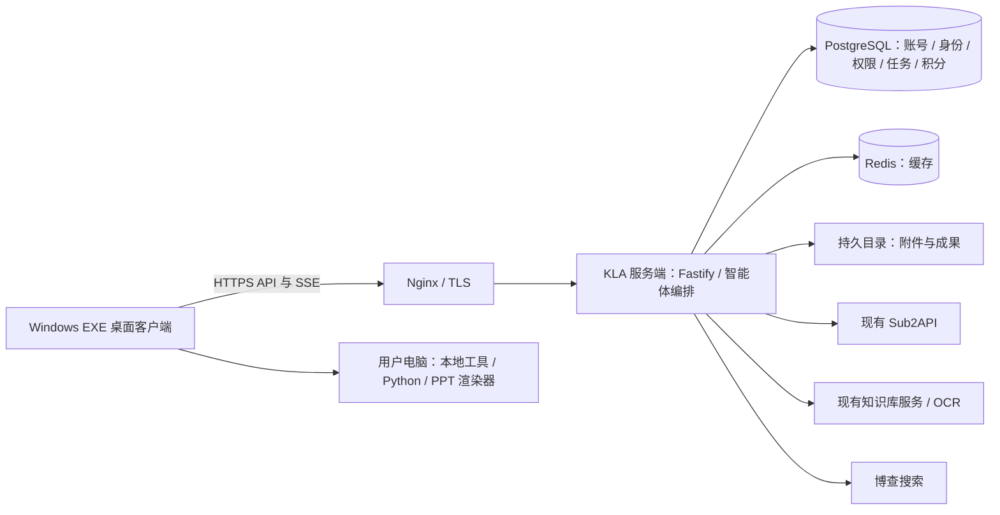

# 鲲擎 KLA-2.0 服务器部署与 Windows EXE 发布方案

日期：2026-10-10。适用项目：`kun-ai-chat`，当前核查代码版本：`fa978e4`。

本文按“Linux 服务器部署业务服务，Windows x64 客户端使用 EXE 安装包”制定。域名、版本、账号及路径中的示例值，部署时须替换为实际值。本文交付部署设计与操作模板，尚未执行生产部署、数据迁移或安装包构建。

## 1. 推荐部署方式

首发采用 **1 个 KLA 服务端实例 + Nginx HTTPS + PostgreSQL + Redis + 持久文件目录**。Sub2API、知识库及 OCR 继续连接现有独立服务；Windows 安装包承担页面展示和本地 read/write/CLI/PPT 执行。



| 部分 | 部署位置 | 职责 |
| --- | --- | --- |
| KLA 服务端 | Linux 服务器 | 登录、身份权限、积分与托管凭据、群聊任务、模型网关、知识权限筛选、工具调度 |
| PostgreSQL | 同服务器或私网数据库 | 权威业务数据；包括 KLA 的知识库归属与权限表 |
| Redis | 同服务器或私网 | 当前服务端已有的缓存与健康检查能力 |
| 文件存储 | `/var/lib/kla/object-storage` | 群聊附件、PPT/PDF/PNG 等共享成果 |
| Sub2API | 现有部署 | 上游账号、模型与额度；由 KLA 服务端调用 |
| 知识库/OCR | 现有部署 | 文件处理、切片、检索、OCR；保留其自身数据库与文件存储 |
| Windows 客户端 | 每位用户电脑 | 内置页面、本地执行审批、文件与 CLI 工具、PPT 技能 |

客户端安装后无需安装 Node.js、pnpm 或本地 KLA 后端，也无需开放入站端口。客户端通过出站请求注册执行设备、轮询工具任务并提交回执。服务器也不需要部署 Vite 开发服务或开放 5173 端口。

PPT 生成目前在用户电脑执行。桌面客户端关闭或切换到其他身份后，本地执行能力会受设备在线状态影响；部署业务服务器不会自动把这些任务转为服务器执行。

## 2. 当前已有能力与发布前缺口

### 2.1 已有能力

- 服务端可编译后运行：`server/dist/server.js`。
- 服务端启动自动执行数据库迁移；也有独立迁移入口。
- 已有 PostgreSQL 权限校验、持久任务步骤、数据库任务租约、本地设备路由与回执。
- 已有磁盘文件存储实现，通过 `OBJECT_STORAGE_PATH` 配置持久目录。
- Electron 已配置 NSIS EXE 安装包、安装目录选择、桌面与开始菜单快捷方式。
- PPT 技能资源已通过 `extraResources` 纳入客户端打包配置。

### 2.2 首发必须完成的调整

| 调整项 | 现状与影响 | 实施方案 | 验收方式 |
| --- | --- | --- | --- |
| 统一客户端 API 地址 | 页面使用构建时的 `VITE_API_BASE_URL`；主进程与 Preload 使用进程环境 `KLA_API_BASE_URL`。两边默认均为 localhost，但只配置页面不会改变本地执行器地址 | 安装包内置公共连接配置，主进程读取后同时提供给 Preload、页面和 LocalRuntime | 从开始菜单启动，在没有开发环境变量的电脑上，登录、设备注册、任务回执均连接生产域名 |
| PPT 运行依赖交付 | 现有 EXE 配置只包含技能代码；Python、Python 库及渲染器没有打入安装包 | 按第 8 节补齐运行环境与探测逻辑 | 干净 Windows 电脑上完成生成、读取、质检、真实渲染及成果回传 |
| 服务端停止信号 | 已有 Fastify `onClose` 清理逻辑，但入口未注册 `SIGTERM`/`SIGINT` 来调用 `app.close()` | 停止时关闭服务、等待后台处理结束，并验证运行租约及本地回执状态 | 重启期间任务状态可恢复，无重复积分结算或重复工具副作用 |
| 发布版本与安装包标识 | 当前包版本为 `0.1.0`，构建产物名称和 x64 发布策略尚未固定 | 固定发布版本、x64 架构、安装包名称；准备 Windows 代码签名 | 安装、覆盖升级、卸载、签名与版本检查通过 |

**当前直接运行 `pnpm package:win` 可以生成安装包，但尚不能据此认定生产客户端完整可用。以上连接地址与 PPT 环境需要先完成。**

目前没有现成 Dockerfile、Compose、Nginx 或自动更新发布配置。本方案首发使用 systemd 托管服务；需要容器化时，再补齐镜像、持久卷和发布配置。客户端首发通过下载新版 EXE 覆盖安装升级，自动更新另行实现。

## 3. 服务器与网络准备

### 3.1 初始配置建议

| 项目 | 建议 |
| --- | --- |
| 系统 | Ubuntu Server 24.04 LTS x64 |
| 小规模试运行 | 4 vCPU、8 GB RAM、100 GB SSD 起步 |
| Node.js | 使用本项目已验证的 Node 24 系列；本次核查环境为 `24.18.1` |
| pnpm | 固定 `11.9.0`，遵循仓库 `packageManager` 和锁文件 |
| PostgreSQL / Redis | PostgreSQL 16、Redis 7 可作为首发选型，正式上线前在目标版本执行迁移与集成验证 |
| 对外地址 | `https://api.example.com/api` |
| 下载地址 | 如 `https://downloads.example.com/`，可使用独立静态托管 |

这是一组初始配置估算，实际并发、文件大小和保留周期仍需压测确认。当前 AgentLoop 单实例每次领取最多 3 个运行任务；增加 CPU 不会自动扩大该限制。外部模型、知识处理和 OCR 的算力需求由对应服务单独规划。

### 3.2 端口与连通性

| 通信 | 要求 |
| --- | --- |
| 客户端 → Nginx | 443；80 用于 HTTPS 跳转及证书签发/续期需要 |
| Nginx → KLA API | 同机 `127.0.0.1:8787`，不对公网开放 |
| API → PostgreSQL / Redis | 5432 / 6379，只允许私网必要来源；同机优先回环地址 |
| API → Sub2API | 必须能访问实际管理 API 与模型 API |
| API → 知识服务/OCR | 必须能访问当前知识服务地址 |
| API → 博查 | HTTPS 出站访问 |

当前知识服务默认地址是内网 `http://192.168.10.206:8120`。如果业务服务器部署在云上，应先建立 VPN、专线或等效私网连通；仅把代码放上云服务器无法访问这台内网服务。客户端的知识操作仍经过 KLA API，不要求每位用户电脑直连知识服务。

生产 HTTPS 证书必须被 Windows 客户端信任。企业自建证书应通过企业管理方式分发信任链。

## 4. 数据、目录与密钥迁移

### 4.1 推荐目录

```text
/opt/kla/releases/<VERSION>/       # 每次发布独立代码与依赖目录
/opt/kla/current                   # 指向当前发布目录的符号链接
/etc/kla/server.env                # 服务端配置与密钥，独立于代码
/var/lib/kla/object-storage/       # 附件与成果，跨版本保留
/var/backups/kla/                  # 数据备份；另复制到异机
```

服务使用独立普通用户 `kla`。代码由发布流程维护，`kla` 只需读取；文件存储目录允许 `kla` 读写；配置文件建议 `root:kla`、`0640`。日志先由 journald 接管，并设置容量与保留期。

### 4.2 迁移既有环境

优先迁移现有业务数据库和数据，保留所有用户、身份、企业、项目、群聊、权限、积分账本及上游账号绑定的 ID，避免重新注册或重新初始化托管账号。

必须一起处理以下数据：

1. **PostgreSQL 数据**：使用 `pg_dump`/`pg_restore` 或数据库平台备份工具。保留当前 `DATABASE_SCHEMA` 和 `schema_migrations` 记录。共享开发库不能直接全库覆盖生产；需要先划清本项目的数据范围及对象依赖。
2. **共享文件**：复制当前有效 `OBJECT_STORAGE_PATH` 的完整内容，保留相对对象 key。仅迁移数据库会造成附件及成果内容缺失。
3. **原算力凭据密钥**：原样迁移 `COMPUTE_SECRET_ENCRYPTION_KEY`。存量密文依赖该密钥，不能在部署时重新随机生成替换。
4. **原知识凭据密钥**：原样迁移 `KNOWLEDGE_SECRET_ENCRYPTION_KEY`；若旧环境没有单独设置，沿用原算力密钥的回退关系。
5. **Sub2API 配置**：保留同一上游实例、管理凭据、分组 ID、账号邮箱域及积分换算规则，核对已有托管绑定与额度。
6. **知识服务数据**：由知识服务维护方保留其数据库、上传原件、切片及索引。本次只部署 KLA，不修改其后端表逻辑。

知识连接保存在 KLA 数据库的 `knowledge_client_state` 中，其中 `connection.json` 带有上游地址。当前代码会拒绝读取“存量连接地址与服务端配置不同”的连接，因此更换 `KNOWLEDGE_BASE_URL` 需要受控迁移或重新配置这些连接，不能只改环境变量。外部知识服务迁移存储位置时，还要由其维护方保证已记录上传路径和文档关联继续有效。

**旧开发实例必须处理**：使用相同数据库与 schema 的开发后台，也会领取生产群聊任务并处理算力同步。上线时应停止这些后台服务，或把开发与生产完全分离为不同数据库、上游测试环境及配置。生产首发只保留一个业务服务进程，不使用 PM2 cluster 或多副本。

### 4.3 备份要求

数据库、文件存储和对应密钥分别备份，并记录所属发布版本与时间。密钥备份使用受控密钥存储，不放进下载目录、Git 或客户端安装包。

切换时先停止所有写入与后台任务，再做最终数据库备份和文件增量同步，以取得一致迁移点。上线后建议每日备份并异机保存；恢复演练覆盖账号登录、身份凭据解密、附件下载和 PPT 成果读取。持续写入的文件目录不能简单假定与任意时刻的数据库备份一致，应使用暂停写入或协调快照。

## 5. 服务端环境配置

建议放到 `/etc/kla/server.env`。以下仅为模板，不含真实凭据：

```dotenv
NODE_ENV=production
HOST=127.0.0.1
PORT=8787
LOG_LEVEL=info

DATABASE_URL=postgresql://kla_app:<URL_ENCODED_PASSWORD>@127.0.0.1:5432/kla_prod
DATABASE_SCHEMA=kla
REDIS_URL=redis://:<URL_ENCODED_PASSWORD>@127.0.0.1:6379/0

OBJECT_STORAGE_PATH=/var/lib/kla/object-storage
OBJECT_STORAGE_MAX_FILE_BYTES=104857600

SUB2API_BASE_URL=https://compute.example.com
SUB2API_ADMIN_API_KEY=<EXISTING_ADMIN_API_KEY>
SUB2API_DEFAULT_GROUP_ID=<EXISTING_GROUP_ID>
SUB2API_PERSONAL_GROUP_ID=<EXISTING_PERSONAL_GROUP_ID>
SUB2API_FAST_GROUP_ID=<EXISTING_FAST_GROUP_ID>
SUB2API_ACCOUNT_EMAIL_DOMAIN=kla.internal
SUB2API_TIMEOUT_MS=15000
SUB2API_MODEL_TIMEOUT_MS=60000
SUB2API_TOOL_MODEL_TIMEOUT_MS=300000

COMPUTE_SECRET_ENCRYPTION_KEY=<ORIGINAL_ENCRYPTION_KEY>
# 若原环境独立设置过知识密钥，则原样设置；否则删除本行并使用原回退规则。
KNOWLEDGE_SECRET_ENCRYPTION_KEY=<ORIGINAL_KNOWLEDGE_ENCRYPTION_KEY>
COMPUTE_USAGE_SYNC_INTERVAL_MS=5000
COMPUTE_OUTBOX_INTERVAL_MS=5000
COMPUTE_MIN_RESERVE_USD=0.01
POINTS_PER_USD=1000
AGENT_STEP_MAX_TURNS=64

KNOWLEDGE_BASE_URL=<SAME_EXISTING_KNOWLEDGE_URL>
BOCHA_API_KEY=<SERVER_SIDE_BOCHA_API_KEY>
```

- 模板中的分组、邮箱域、积分汇率和超时只是示例/默认值。迁移现有环境时以有效原配置为准，不自行重估存量积分。
- 密钥格式必须满足代码要求：32 字节，hex 或 base64 编码；新建空环境可生成新密钥，迁移存量环境必须沿用原密钥。
- `SUB2API_BASE_URL` 必须是完整 HTTP(S) 地址，不可写成客户端相对路径 `/api`。
- `SUB2API_TIMEOUT_MS` 控制管理调用；模型与工具模型续跑分别使用另外两个超时。它们不是整个智能体任务的总时长上限。
- `AGENT_STEP_MAX_TURNS` 是单步骤模型/工具交互轮数，不是持续运行一天的保证。任务长时间运行需要分步、检查点、设备在线和上游服务配合。
- 知识请求与上传超时保存在知识连接设置中，当前默认分别为 120 秒和 300 秒；调整时使用已有连接配置入口。
- 当前文件存储实际读取 `OBJECT_STORAGE_PATH`。示例文件里的 S3/MinIO 字段属于预留配置，不能仅填这些字段就使用 S3。
- 当前登录基于数据库会话，不依赖示例文件中的预留 JWT 配置。部署时不要用未接入的配置替代已实现机制。

通过 `DOTENV_CONFIG_PATH=/etc/kla/server.env` 指定配置路径。生产运行不依赖发布目录里的开发 `.env`。所有模型、博查、数据库和加密密钥只留在服务端。

## 6. 服务端构建、迁移与启动

### 6.1 构建发布目录

在 Linux 构建机或目标服务器的新发布目录操作，使用同一批准版本的源码及 `pnpm-lock.yaml`。不拷贝 Windows 的 `node_modules` 到 Linux。

```bash
cd /opt/kla/releases/<VERSION>

# 安装服务端及其 workspace 依赖，保留编译所需开发依赖。
pnpm --filter @kla-workstation/server... install --frozen-lockfile
pnpm --filter @kla-workstation/contracts build
pnpm --filter @kla-workstation/server build
```

首发可保留上述 workspace 目录和安装好的依赖，再由 systemd 直接运行编译结果。运行时必需的内容包括 `server/dist`、编译后 SQL 迁移目录、`packages/contracts/dist` 以及对应依赖与 pnpm 链接结构。**只拷贝 `server/dist` 不能独立运行。**

正式发布流程可在 Linux 构建环境制作经过验证的服务端包。不要直接跨系统复制依赖，也不要把尚未验证的 workspace 裁剪命令作为生产步骤。

### 6.2 数据库准备与迁移

- 空库：创建独立数据库和应用角色，允许创建本项目 schema、表、索引等对象；由 DBA 提前安装/授权 `pgcrypto` 扩展。
- 存量库：先备份/恢复现有数据，再运行增量迁移。恢复时核对对象 owner 与 schema 权限。
- 当前服务启动时仍会检查并执行迁移，所以应用角色需要满足迁移权限，不能未经调整就改成只允许普通 CRUD 的角色。
- 迁移代码目前没有全局迁移锁。升级期间停止旧服务，串行执行迁移，避免多个新实例同时初始化同一库。

使用编译后的独立入口预先迁移：

```bash
sudo -u kla env NODE_ENV=production \
  DOTENV_CONFIG_PATH=/etc/kla/server.env \
  /usr/local/bin/node /opt/kla/releases/<VERSION>/server/dist/database/migrate-cli.js
```

`/usr/local/bin/node` 是示例，替换为安装 Node 后的实际绝对路径。该入口只执行迁移并校验数据库，不启动群聊后台任务。服务启动再次检查时，已记账的迁移会跳过。不要把数据库恢复、积分重估或手工改账混入普通启动流程。

### 6.3 systemd 模板

文件：`/etc/systemd/system/kla-api.service`。

```ini
[Unit]
Description=KLA Workstation API
After=network-online.target
Wants=network-online.target

[Service]
Type=simple
User=kla
Group=kla
WorkingDirectory=/opt/kla/current/server
EnvironmentFile=/etc/kla/server.env
Environment=DOTENV_CONFIG_PATH=/etc/kla/server.env
ExecStart=/usr/local/bin/node /opt/kla/current/server/dist/server.js
Restart=on-failure
RestartSec=5
KillSignal=SIGTERM
TimeoutStopSec=90
UMask=0027
StandardOutput=journal
StandardError=journal

[Install]
WantedBy=multi-user.target
```

数据库与 Redis 同机时，还应配置对应服务依赖并先确认它们就绪；私网托管服务则通过健康检查确认。`TimeoutStopSec` 不是对任务执行时长的限制，停止行为仍需完成第 2 节的信号处理改动并实测。

指向发布目录、启用并检查服务：

```bash
sudo ln -sfn /opt/kla/releases/<VERSION> /opt/kla/current
sudo systemctl daemon-reload
sudo systemctl enable --now kla-api
sudo systemctl status kla-api
sudo journalctl -u kla-api -n 100 --no-pager

curl --fail http://127.0.0.1:8787/api/health
curl --fail http://127.0.0.1:8787/api/health/database
curl --fail http://127.0.0.1:8787/api/health/redis
```

以上三个健康接口只验证对应进程/数据库/Redis，不代表模型、知识、OCR 或 PPT 已经完成业务验收。

## 7. Nginx、HTTPS 与文件传输

先准备域名 DNS 和有效证书。以下模板假定证书路径已经存在，替换实际域名及证书后再加载：

```nginx
server {
    listen 80;
    server_name api.example.com;
    return 301 https://$host$request_uri;
}

server {
    listen 443 ssl;
    server_name api.example.com;

    ssl_certificate /etc/letsencrypt/live/api.example.com/fullchain.pem;
    ssl_certificate_key /etc/letsencrypt/live/api.example.com/privkey.pem;

    client_max_body_size 100m;
    client_body_timeout 300s;

    # 带数据库/Redis详情的诊断接口仅在本机运维使用。
    location = /api/health/database { return 404; }
    location = /api/health/redis { return 404; }

    location /api/ {
        # 不加 URI 后缀，保持 /api/... 原路径。
        proxy_pass http://127.0.0.1:8787;
        proxy_http_version 1.1;
        proxy_set_header Host $host;
        proxy_set_header X-Real-IP $remote_addr;
        proxy_set_header X-Forwarded-For $proxy_add_x_forwarded_for;
        proxy_set_header X-Forwarded-Proto $scheme;
        proxy_set_header Connection "";

        proxy_buffering off;
        proxy_cache off;
        proxy_read_timeout 1800s;
        proxy_send_timeout 1800s;
        proxy_next_upstream off;
    }
}
```

校验配置并重载后，检查 `https://api.example.com/api/health`。如果前面还有 CDN、负载均衡或网关，同样需要放行 SSE、上传大小与长连接；首发 API 可直接走 Nginx。

| 当前限制 | 代码中的有效值 |
| --- | --- |
| 普通群聊文件上传 | `OBJECT_STORAGE_MAX_FILE_BYTES`，默认 100 MiB |
| 知识库上传 | 契约固定 50 MiB，不能通过上面的普通文件变量提高 |
| 本地工具回执请求体 | 48 MiB，包含成果的 base64/JSON 开销 |
| 本地 PPT 单个回传文件 / 一次总成果 | 16 MiB / 32 MiB |
| 当前 OCR 工具输入 | 有权访问的 PDF 成果，不超过 16 MiB |

Nginx 的 100m 只是入口上限，业务路由的更小限制仍然生效。上传读取到内存，首发需要监控并发大文件带来的内存峰值。

SSE 必须关闭反向代理缓存。`proxy_read_timeout` 是上游读空闲超时，不是群聊任务总时长。当前没有对所有任务提供“一条 HTTP 连接持续一天”的承诺，应使用已有持久任务状态与检查点，并验证断线后重新获取状态。

当前 Fastify CORS 接受请求来源；发布配置调整时要支持 Electron `file://` 页面的来源和必要请求头，包括 `Authorization`、`x-identity-id`。不要只允许 Vite 的 localhost 来源。公网接入时在入口为登录/注册配置合理的限流并验证正常客户端登录，具体阈值按实际使用量确定。

## 8. Windows EXE 安装包交付

### 8.1 统一连接配置

建议新增 `apps/desktop/resources/client-config.json`，随安装包作为公共资源发布，例如：

```json
{
  "apiBaseUrl": "https://api.example.com/api",
  "knowledgeServiceUrl": "<SAME_EXISTING_KNOWLEDGE_URL>"
}
```

此文件只放公共地址。实施流程：

1. 主进程启动时读取并验证该文件，生产地址要求 HTTPS；开发环境保留受控覆盖入口。
2. 同一解析结果传给 `LocalRuntime` 和 Preload。Preload 在 sandbox 下不自行读取文件，可由主进程通过 `additionalArguments` 等现有隔离机制传入公共配置。
3. 页面 API 客户端优先使用 Preload 提供的公共地址；浏览器开发模式再使用 `VITE_API_BASE_URL`。
4. 知识页的地址校验使用同一配置，或改为从服务端读取实际连接信息；继续保证上传和检索通过 KLA API。
5. builder 增加该文件的 `extraResources` 配置。安装后从快捷方式启动即可使用，不依赖构建电脑的环境变量。

仅在打包电脑设置 `KLA_API_BASE_URL` 不会把该进程环境自动保存到其他用户的安装包里。页面的 `VITE_API_BASE_URL` 虽能编译进去，也不能单独解决主进程地址。因此统一配置是发布前的代码改动，不是用户手工设置环境变量的长期方案。

### 8.2 PPT 依赖

首发客户端建议附带固定版本的 Windows x64 Python 运行环境与 `python-pptx`、`Pillow`、`pypdfium2`，避免每位用户自行在线安装。PPT 渲染采用当前实际支持的 LibreOffice `soffice`，或能被探测到的 WPS `kwpsconvert.exe`。

若要求“一个 EXE 安装后即完整制作与预览 PPT”，安装发行物还需要交付可用的 LibreOffice 运行环境或安装组件。若采用已安装 WPS，则应明确 WPS 是客户端前置条件。**仅安装 Microsoft PowerPoint，当前代码不会自动选择它作为渲染后端。**

需要补齐的打包工作：

- 构建并验证可搬移的 Python 运行包，固定依赖版本与 Windows x64 二进制库；不能直接复制开发机 `.venv` 当成通用运行包。
- 增加运行包到 `extraResources`，在 `local-ppt.cjs` 增加安装资源内 Python 的查找；保留用户显式指定 `KLA_PPT_PYTHON` 的优先级。
- 若附带 LibreOffice，将其可执行目录提供给 Python 子进程，使当前 `soffice` 探测可找到；在安装目录含空格、中文及普通用户权限下验证。
- 验证微软雅黑或思源黑体等中文字体。若附带字体，还需把字体实际安装/搜索机制接入渲染器与环境检查，单纯复制字体文件不等于已可使用。
- 随发行物提供所包含第三方组件的许可证说明。
- 首次启动和 PPT 调用前运行 `local_ppt_doctor`。生成、质检、渲染、中文字体能力分别检查；环境不完整时给出安装提示。

现有 `scripts/setup-ppt-runtime.ps1` 可用于开发/受控试点：要求已有 Python 3.10+，再在线创建用户虚拟环境、安装依赖。它依赖源码目录结构，目前并非 EXE 安装器中的通用初始化脚本。

本地 read/write/CLI/BAT/PPT 继续要求用户审批。不要为了安装后“工具可用”取消审批或让客户端以管理员身份常驻。指定写入目录的权限应由安装环境和用户配置提供。

### 8.3 打包步骤

在 Windows x64 构建机使用批准的发布版本。先完成第 2 节和本节要求的发布改动，并配置公共连接文件，再执行：

```powershell
Set-Location 'E:\codex_program\KLA-2.0\kun-ai-chat'
pnpm install --frozen-lockfile
pnpm --filter @kla-workstation/contracts build

# 当前页面仍有构建时配置；统一运行配置后也要保证回退值一致。
$env:VITE_API_BASE_URL = 'https://api.example.com/api'
$env:VITE_KNOWLEDGE_BASE_URL = '<SAME_EXISTING_KNOWLEDGE_URL>'
pnpm --filter @kla-workstation/desktop build
pnpm --filter @kla-workstation/desktop exec electron-builder --win nsis --x64
```

现有快捷脚本为根目录 `pnpm package:win`，上面显式指定 x64。输出目录是 `apps/desktop/release/`。建议在 builder 中固定产物名为 `KLA-Workstation-Setup-<VERSION>-x64.exe`，并保持 `appId=com.kla.workstation` 稳定。

正式发行物建议包括：签名的 EXE 安装包、SHA-256 校验文件、版本说明、必要运行环境/许可证说明。安装包、签名证书及签名服务凭据的配置由发布流程管理，证书密码不写入仓库。

### 8.4 安装与升级行为

- 使用 NSIS 引导安装，保留安装目录选择与快捷方式。
- 用户数据及本地任务工作区留在 Electron `userData`，不写入安装目录。
- 覆盖升级保持 appId 和用户数据路径稳定，保留设备标识、任务回执日志等状态。
- 卸载清理策略应明确区分程序文件和用户产生的数据，不自动删除待回传成果。
- 当前未实现客户端自动更新。首发从可信 HTTPS 下载页获取新版本 EXE，校验后覆盖安装；后续再实现签名更新、版本兼容与灰度发布。

## 9. 验收与上线顺序

### 9.1 发布前验证

在隔离测试环境执行 `pnpm ci-check`。需要数据库的集成测试使用独立测试库、独立 schema 及测试上游配置。部分测试会创建账号、启动后台任务，不能让测试继承生产 `.env` 或直接连接生产库。

必须完成的业务验收：

| 场景 | 通过标准 |
| --- | --- |
| 登录及身份切换 | 个人、企业身份切换正确，请求携带真实身份 ID；账号 ID 不代替身份 ID |
| 算力初始化与积分 | 新身份初始化完成；已有身份无需重建；托管凭据可解密；一次调用只发生一次有效结算 |
| 普通群聊任务 | 能出答案、显示进度；客户端断线后可重新取得任务状态 |
| 本地 read/write/CLI | 生产 API 上设备在线；审批允许后成功；拒绝审批得到明确状态；路径权限按现有规则生效 |
| 知识库 | 企业、项目、个人范围分别上传与检索；任务、切片及统计可读取；切换身份、非成员访问受到正确限制 |
| OCR | 有权限的 PDF 成果调用 OCR 并取得实际返回；非法类型、超限、无权限输入按约定拒绝 |
| 博查搜索 | 服务端密钥有效；智能体具备对应技能/工具挂载并可取得搜索结果 |
| PPT | 干净 Windows 上环境检查、生成、质检、渲染、上传、预览及下载全部完成 |
| 服务重启 | 停止信号触发清理；未确认的工具调用按现有规则处理，不直接重放副作用 |
| 安装与升级 | 普通用户从开始菜单启动即可工作；不依赖开发电脑环境变量；升级保留任务与设备数据 |

### 9.2 首次上线顺序

1. 确定域名、服务器、数据库位置、外部服务连通方式及发布版本。
2. 完成客户端统一地址、PPT 依赖、服务停止信号及发行配置。
3. 隔离环境验证服务端与 EXE，备好旧版本和恢复材料。
4. 进入维护窗口，停止旧实例与所有写入；执行最终备份和数据同步。
5. 在新服务器配置原密钥与上游参数，恢复数据库和共享文件。
6. 串行运行数据库迁移；启动单个 KLA 服务；验证本机健康。
7. 启用 HTTPS 入口，核验账号、凭据、积分、知识与文件。
8. 发布 EXE，先让少量用户安装，验证真实本地工具与 PPT 链路。
9. 扩大发布，监控模型错误、任务状态、初始化积压、数据库连接、文件容量及积分同步。

## 10. 更新、回滚与后续扩容

### 10.1 服务端更新

新版本先进入独立 release 目录构建和验证。维护窗口内停止旧实例，备份后串行迁移，再切换 `current` 并启动。文件目录和密钥保持独立，不随代码目录切换。

### 10.2 回滚

- 未改变数据库结构，或确认新结构与旧版本兼容：停止新实例，切回旧 release 后启动。
- 迁移不兼容：不能只切代码。应停止写入，按已验证方案恢复兼容数据库、对应文件快照和原配置。
- 恢复会丢失备份之后的写入，应在维护窗口明确恢复点。
- 积分、Sub2API 额度和工具外部副作用不能靠数据库回滚自动撤销，需要结合账本、同步记录和上游状态核对。

### 10.3 扩容前置条件

目前 AgentLoop 已使用数据库租约与 `SKIP LOCKED` 领取任务，但整体多实例能力还需分别验证。扩容前至少确认：

- 所有实例相同代码版本、数据库、原始加密密钥、Sub2API 与知识连接配置。
- 共享附件/成果存储；当前磁盘适配器需要共享挂载，或完成真正的 S3/MinIO 适配。
- Outbox、UsageSync、记忆清理等后台工作的并发与幂等行为。
- 知识模块的进程内连接/任务缓存及配置更新传播。
- 连接池、任务并发限制、设备断线与回执恢复，以及升级期间的串行迁移。

首发建议先把单实例部署、备份和恢复跑稳，再根据真实负载进行 API/Worker 拆分和水平扩容。

## 11. 实施交付清单

| 交付物 | 内容 |
| --- | --- |
| 服务端发布目录/包 | Linux 构建结果、workspace 依赖、SQL 迁移文件及版本记录 |
| 部署配置 | 实际 systemd、Nginx、环境配置模板与私网连接说明 |
| 数据迁移记录 | 数据库与文件备份、原密钥的受控保存、迁移结果及恢复点 |
| Windows EXE | 固定版本与架构、统一公共连接配置、PPT 运行环境、签名及校验值 |
| 验收记录 | 身份权限、模型积分、知识 OCR、搜索、本地工具、PPT、升级与重启结果 |
| 运维说明 | 启停、日志、备份、恢复、更新、回滚与异常排查 |

## 12. 源码依据

- 根目录 `package.json`、`pnpm-workspace.yaml`：Node/pnpm、构建、检查和打包命令。
- `server/src/server.ts`、`server/src/config.ts`：服务入口、后台工作、关闭钩子与实际读取的配置。
- `server/src/database/migrations.ts`、`migrate-cli.ts`、`server/scripts/copy-migrations.mjs`：迁移加载、记账及编译打包。
- `server/src/storage/object-store.ts`、`storage/routes.ts`：当前磁盘存储和文件上传。
- `server/src/infrastructure/agent-loop.ts`、`runtime/routes.ts`：任务租约、步骤、设备与成果回执。
- `server/src/knowledge-api/config.ts`、`context.ts`、`routes.ts`：知识连接、身份隔离、持久配置及上传。
- `server/src/runtime/tools.ts`：知识检索、OCR、网页搜索及本地工具入口。
- `apps/desktop/src/api/client.ts`、`desktop/main.cjs`、`desktop/preload.cjs`：客户端 API 地址与桥接。
- `apps/desktop/electron-builder.yml`：NSIS、安装选项和当前 extraResources。
- `apps/desktop/desktop/local-ppt.cjs`、`resources/skills/deck-agent-kit/scripts/pptkit/doctor.py`：Python 发现、PPT 能力和渲染器探测。
- `docs/FILE_STORAGE_AND_CROSS_DEVICE_COLLABORATION.md`、`docs/PPT_ASSISTANT_IMPLEMENTATION.md`：文件与 PPT 现有实现边界。

## 13. 本次方案核查记录

本次仅新增本文档。已在不加载生产配置、不连接业务数据库的环境运行 `pnpm ci-check`：类型检查、lint、316 项测试及前后端构建通过；19 项测试因缺少数据库连接或平台条件被跳过。该结果不替代目标服务器上的数据库迁移、外部服务联调和干净 Windows 安装验收。尚未生成 EXE 安装包。
